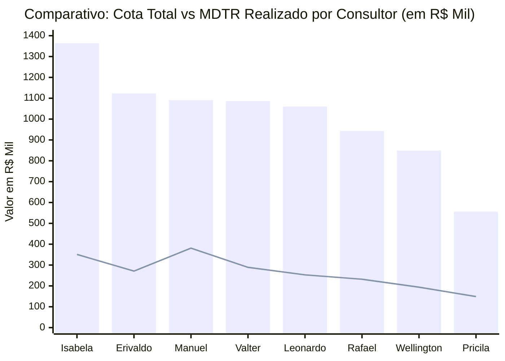

# Relatório de Análise Comercial: Setores, Cota, MDTR e Linhas Estratégicas
**Gerência Regional / Equipe:** 847010600 - JOSÉ CABRAL NETO  
**Arquivo Base:** [Acompanhamento 847010600 Outubro26.xlsx](file:///c:/Users/jose.cabral/OneDrive%20-%20Hypera/Documentos/Aula%20IA/Acompanhamento%20847010600%20Outubro26.xlsx)  
**Posição dos Dados:** MDTR até 09/10/2026 | Faturamento Bruto (Sales) até 13/10/2026  
**Dias Úteis no Mês:** 21 dias úteis (8 decorridos até 13/10 | 13 dias úteis restantes)

---

## 1. Resumo Executivo da Regional

| Indicador | Valor Consolidado (R$) | % Atingimento / Cobertura | Status e Observação |
| :--- | :---: | :---: | :--- |
| **Cota Total Regional** | **R$ 8.071.973,31** | 100,0% | Meta total estabelecida para Outubro/2026 |
| **MDTR Consolidado (09/10)** | **R$ 2.120.257,37** | **26,3%** | Ritmo acelerado de entrada de pedidos |
| **Faturamento Bruto (13/10)** | **R$ 1.428.579,15** | **17,7%** | Faturamento efetivamente faturado |
| **GAP Restante para Cota 100%** | **-R$ 6.643.394,16** | 82,3% | Saldo pendente para encerramento do mês |
| **Meta Intermediária Regional** | **R$ 4.893.633,82** | **60,6%** | Alvo intermediário da regional |
| **GAP Meta Intermediária** | **-R$ 3.465.054,67** | - | Montante a faturar para atingir o marco intermediário |

> [!NOTE]
> No corte de 13/10, haviam transcorrido **38,1% dos dias úteis** do mês (8 de 21 dias). O faturamento realizado atingiu 17,7% da cota com MDTR em 26,3%, demonstrando forte conversão de pedidos em faturamento na regional.

---

## 2. Gráfico e Ranking dos Setores: Cota vs MDTR

> 📊 **Painel Visual Interativo Disponível**: Abra o dashboard completo no navegador em:  
> 👉 **[grafico_ranking_setores.html](file:///c:/Users/jose.cabral/OneDrive%20-%20Hypera/Documentos/Aula%20IA/grafico_ranking_setores.html)** ou no **[GitHub Pages](https://cabralnetto26-ship-it.github.io/Acompanhamento-Outubro/)**

### 2.1. Gráfico de Cobertura de MDTR (%) vs Cota

O gráfico abaixo classifica os consultores do **1º ao 8º lugar**, ilustrando visualmente o percentual da cota já alcançado no MDTR frente à média regional (**26,3%**):

```text
Classificação | Consultor               | Cob. MDTR (%) | Gráfico de Barra Visual (Escala até 40%)
----------------------------------------------------------------------------------------------------
 1º LUGAR     | Manuel Artero           | 34,9%         | [███████████████████████████████████] ★ Líder
 2º LUGAR     | Pricila Moreira         | 26,8%         | [███████████████████████████        ]
 3º LUGAR     | Valter Pereira Jr       | 26,7%         | [███████████████████████████        ]
----------------------------------------- MÉDIA REGIONAL: 26,3% ------------------------------------
 4º LUGAR     | Isabela Cruccitti       | 25,7%         | [██████████████████████████         ]
 5º LUGAR     | Rafael Nascimento       | 24,6%         | [█████████████████████████          ]
 6º LUGAR     | Erivaldo Maciel         | 24,1%         | [████████████████████████           ]
 7º LUGAR     | Leonardo Mazzuco        | 23,8%         | [████████████████████████           ]
 8º LUGAR     | Wellington Morais       | 22,8%         | [███████████████████████            ]
```

### 2.2. Comparativo de Volume Financeiro: Cota Total vs MDTR Realizado (R$)


*(Legenda: Colunas azuis = Cota Total em R$ Mil | Linha verde = MDTR realizado até 09/10 em R$ Mil)*

---

## 3. Ritmo Diário e Plano de Ação por Consultor (MDTR Necessário)

Para que cada consultor alcance **100% da sua cota** nos **13 dias úteis restantes** de Outubro, é necessário manter o seguinte ritmo diário:

| Setor / Consultor | Cota Total (R$) | Faturado (13/10) | Gap Cota 100% (R$) | Faturamento Atual / Dia | **MDTR Diário Necessário (13 d.u.)** | Fator de Aceleração | Meta Interm. (R$) | **GAP Intermediária (R$)** |
| :--- | :---: | :---: | :---: | :---: | :---: | :---: | :---: |
| **847010607 - Manuel Artero** | R$ 1.090.998,13 | R$ 201.177,41 | R$ 889.820,72 | R$ 25.147,18 | **R$ 68.447,75 / dia** | **2,7x** | R$ 752.788,71 | -R$ 551.611,30 |
| **847010606 - Pricila Moreira** | R$ 556.481,27 | R$ 88.265,37 | R$ 468.215,90 | R$ 11.033,17 | **R$ 36.016,61 / dia** | **3,3x** | R$ 189.203,63 | -R$ 100.938,26 |
| **847010608 - Valter Pereira Jr** | R$ 1.085.968,45 | R$ 148.632,49 | R$ 937.335,96 | R$ 18.579,06 | **R$ 72.102,77 / dia** | **3,9x** | R$ 705.879,49 | -R$ 557.247,00 |
| **847010605 - Isabela Cruccitti** | R$ 1.363.710,73 | R$ 326.031,50 | R$ 1.037.679,23 | R$ 40.753,94 | **R$ 79.821,48 / dia** | **2,0x** | R$ 940.960,40 | -R$ 614.928,90 |
| **847010601 - Rafael Nascimento** | R$ 942.882,94 | R$ 133.047,97 | R$ 809.834,97 | R$ 16.631,00 | **R$ 62.294,99 / dia** | **3,7x** | R$ 518.585,62 | -R$ 385.537,65 |
| **847010603 - Erivaldo Maciel** | R$ 1.122.794,36 | R$ 182.801,87 | R$ 939.992,49 | R$ 22.850,23 | **R$ 72.307,11 / dia** | **3,2x** | R$ 774.728,11 | -R$ 591.926,24 |
| **847010604 - Leonardo Mazzuco** | R$ 1.060.357,11 | R$ 211.890,17 | R$ 848.466,94 | R$ 26.486,27 | **R$ 65.266,69 / dia** | **2,5x** | R$ 731.646,41 | -R$ 519.756,24 |
| **847010602 - Wellington Morais** | R$ 848.780,32 | R$ 136.732,37 | R$ 712.047,95 | R$ 17.091,55 | **R$ 54.772,92 / dia** | **3,2x** | R$ 466.829,18 | -R$ 330.096,81 |
| **TOTAL GERAL REGIONAL** | **R$ 8.071.973,31** | **R$ 1.428.579,15** | **R$ 6.643.394,16** | **R$ 178.572,39** | **R$ 511.030,32 / dia** | **2,9x** | **R$ 4.893.633,82** | **-R$ 3.465.054,67** |

---

## 4. Cobertura de Carteira e Positivação (HYMPAR)

| Consultor / Setor | Clientes na Base | Meta Positivação | Positivados PH | % Atingido | Saldo / Gap |
| :--- | :---: | :---: | :---: | :---: | :---: |
| **847010604 - Leonardo Mazzuco** | 130 | 104 | 93 | **89,4%** | -11 |
| **847010605 - Isabela Cruccitti** | 140 | 112 | 95 | **84,8%** | -17 |
| **847010607 - Manuel Artero** | 135 | 108 | 86 | **79,6%** | -22 |
| **847010602 - Wellington Morais** | 140 | 112 | 73 | **65,2%** | -39 |
| **847010608 - Valter Pereira Jr** | 138 | 110 | 71 | **64,5%** | -39 |
| **847010603 - Erivaldo Maciel** | 139 | 111 | 66 | **59,5%** | -45 |
| **847010601 - Rafael Nascimento** | 143 | 114 | 61 | **53,5%** | -53 |
| **847010606 - Pricila Moreira** | 132 | 106 | 34 | **32,1% ⚠️** | -72 |
| **TOTAL REGIONAL** | **1.097** | **878** | **579** | **66,0%** | **-299** |

---

## 5. Diagnóstico por Rede Farmacêutica (BASE 600)

| Rede Farmacêutica | Lojas na Base | Cota Total (R$) | Faturado (R$) | % Cobertura | Status e Comportamento |
| :--- | :---: | :---: | :---: | :---: | :--- |
| **FARMARCAS** | 134 | R$ 1.908.084,28 | R$ 343.344,00 | **18,0%** | Maior volume da regional (Ultra Popular, Drogatop). |
| **INDEPENDENTES VIN** | 334 | R$ 1.626.198,58 | R$ 268.049,69 | **16,5%** | Forte tração no canal direto. |
| **ASSOCIADAS** | 184 | R$ 1.179.269,92 | R$ 180.370,17 | **15,3%** | Boa tração de compras na primeira quinzena. |
| **HIPER SAÚDE** | 66 | R$ 507.636,64 | R$ 101.409,91 | **20,0%** | Grande peso nos setores de MS e MT. |
| **MASTERFARMA** | 98 | R$ 474.946,27 | R$ 54.498,90 | **11,5%** | Adesão consistente ao faturamento. |
| **REDE SANTA CATARINA** | 38 | R$ 395.139,60 | R$ 77.479,11 | **19,6%** | Recuperação sólida no setor Manuel Artero. |
| **ECONOMIZE RONDONÓPOLIS** | 41 | R$ 373.128,52 | R$ 108.782,51 | **29,2%** | Destaque em MT (Isabela/Leonardo/Erivaldo). |
| **DROGARIA TOTAL** | 30 | R$ 238.230,26 | R$ 34.132,29 | **14,3%** | Faturamento constante. |
| **COMPRE BEM** | 28 | R$ 191.669,21 | R$ 31.913,51 | **16,7%** | Faturamento constante. |
| **DSG FARMA** | 35 | R$ 159.747,06 | R$ 38.831,18 | **24,3%** | Alta cobertura em redes organizadas. |

---

## 6. Recomendações e Plano Tático

1. **Aceleração da Positivação HYMPAR**:
   - Atenção focada para o setor de **Pricila Moreira** (apenas 34 positivados de 106).
   - Apoiar **Rafael Nascimento** (61/114) e **Erivaldo Maciel** (66/111) para atingir os 80% da carteira.
2. **Conversão de Carteira em Faturamento**:
   - A regional possui **R$ 2.120.257,37 no MDTR** e **R$ 1.428.579,15 faturados** (R$ 691k de saldo entre pedido e expedição).
   - Monitorar diariamente liberação de crédito e expedição para acelerar o faturamento.
3. **Atingimento da Meta Intermediária (R$ 4.893.633,82)**:
   - Saldo restante de **R$ 3.465.054,67**, exigindo um ritmo diário de faturamento de aproximadamente **R$ 266,5k / dia** nos 13 dias úteis restantes.
