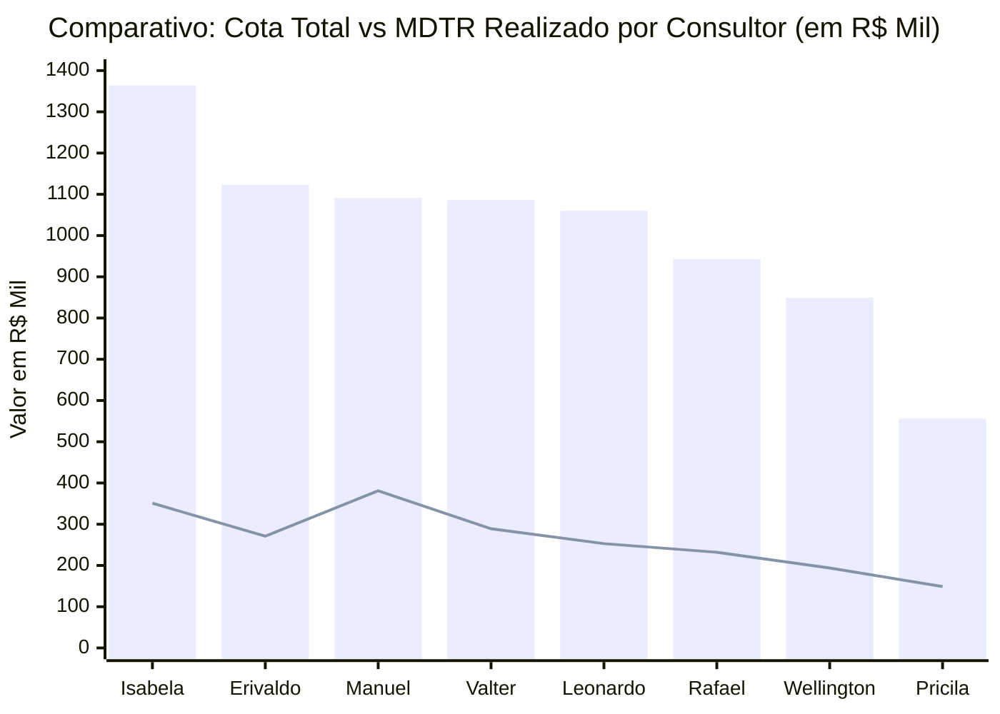
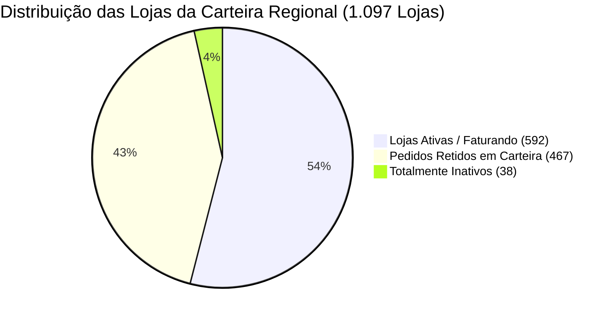

# Relatório de Análise Comercial: Setores, Cota, MDTR e Linhas Estratégicas
**Gerência Regional / Equipe:** 847010600 - JOSÉ CABRAL NETO  
**Arquivo Base:** [Acompanhamento 847010600 Outubro26.xlsx](file:///c:/Users/jose.cabral/OneDrive%20-%20Hypera/Documentos/Aula%20IA/Acompanhamento%20847010600%20Outubro26.xlsx)  
**Posição dos Dados:** MDTR até 09/10/2026 | Faturamento Bruto (Sales) até 13/10/2026  
**Dias Úteis no Mês:** 21 dias úteis (8 decorridos até 13/10 | 13 dias úteis restantes)

---

## 1. Resumo Executivo da Regional

| Indicador | Valor Consolidado (R$) | % Atingimento / Cobertura | Status e Observação |
| :--- | :---: | :---: | :--- |
| **Cota Total Regional** | **R$ 8.071.973,31** | 100,0% | Meta total estabelecida para Outubro/2026 |
| **MDTR Consolidado (09/10)** | **R$ 2.120.257,37** | **26,3%** | Ritmo acelerado de entrada de pedidos |
| **Faturamento Bruto (13/10)** | **R$ 1.428.579,15** | **17,7%** | Faturamento efetivamente faturado |
| **GAP Restante para Cota 100%** | **-R$ 6.643.394,16** | 82,3% | Saldo pendente para encerramento do mês |
| **Meta Intermediária Regional** | **R$ 4.893.633,82** | **60,6%** | Alvo intermediário da regional |
| **GAP Meta Intermediária** | **-R$ 3.465.054,67** | - | Montante a faturar para atingir o marco intermediário |

> [!NOTE]
> No corte de 13/10, haviam transcorrido **38,1% dos dias úteis** do mês (8 de 21 dias). O faturamento realizado atingiu 17,7% da cota com MDTR em 26,3%, demonstrando forte conversão de pedidos em faturamento na regional.

---

## 2. Gráfico e Ranking dos Setores: Cota vs MDTR

> 📊 **Painel Visual Interativo Disponível**: Abra o dashboard completo no navegador em:  
> 👉 **[grafico_ranking_setores.html](file:///c:/Users/jose.cabral/OneDrive%20-%20Hypera/Documentos/Aula%20IA/grafico_ranking_setores.html)** ou no **[GitHub Pages](https://cabralnetto26-ship-it.github.io/Acompanhamento-Outubro/)**

### 2.1. Gráfico de Cobertura de MDTR (%) vs Cota

O gráfico abaixo classifica os consultores do **1º ao 8º lugar**, ilustrando visualmente o percentual da cota já alcançado no MDTR frente à média regional (**26,3%**):

```text
Classificação | Consultor               | Cob. MDTR (%) | Gráfico de Barra Visual (Escala até 40%)
----------------------------------------------------------------------------------------------------
 1º LUGAR     | Manuel Artero           | 34,9%         | [███████████████████████████████████] ★ Líder
 2º LUGAR     | Pricila Moreira         | 26,8%         | [███████████████████████████        ]
 3º LUGAR     | Valter Pereira Jr       | 26,7%         | [███████████████████████████        ]
----------------------------------------- MÉDIA REGIONAL: 26,3% ------------------------------------
 4º LUGAR     | Isabela Cruccitti       | 25,7%         | [██████████████████████████         ]
 5º LUGAR     | Rafael Nascimento       | 24,6%         | [█████████████████████████          ]
 6º LUGAR     | Erivaldo Maciel         | 24,1%         | [████████████████████████           ]
 7º LUGAR     | Leonardo Mazzuco        | 23,8%         | [████████████████████████           ]
 8º LUGAR     | Wellington Morais       | 22,8%         | [███████████████████████            ]
```

### 2.2. Comparativo de Volume Financeiro: Cota Total vs MDTR Realizado (R$)


*(Legenda: Colunas azuis = Cota Total em R$ Mil | Linha verde = MDTR realizado até 09/10 em R$ Mil)*

---

## 3. Ritmo Diário e Plano de Ação por Consultor (MDTR Necessário)

Para que cada consultor alcance **100% da sua cota** nos **13 dias úteis restantes** de Outubro, é necessário manter o seguinte ritmo diário:

| Setor / Consultor | Cota Total (R$) | Faturado (13/10) | Gap Cota 100% (R$) | Faturamento Atual / Dia | **MDTR Diário Necessário (13 d.u.)** | Fator de Aceleração | Meta Interm. (R$) | **GAP Intermediária (R$)** |
| :--- | :---: | :---: | :---: | :---: | :---: | :---: | :---: |
| **847010607 - Manuel Artero** | R$ 1.090.998,13 | R$ 201.177,41 | R$ 889.820,72 | R$ 25.147,18 | **R$ 68.447,75 / dia** | **2,7x** | R$ 752.788,71 | -R$ 551.611,30 |
| **847010606 - Pricila Moreira** | R$ 556.481,27 | R$ 88.265,37 | R$ 468.215,90 | R$ 11.033,17 | **R$ 36.016,61 / dia** | **3,3x** | R$ 189.203,63 | -R$ 100.938,26 |
| **847010608 - Valter Pereira Jr** | R$ 1.085.968,45 | R$ 148.632,49 | R$ 937.335,96 | R$ 18.579,06 | **R$ 72.102,77 / dia** | **3,9x** | R$ 705.879,49 | -R$ 557.247,00 |
| **847010605 - Isabela Cruccitti** | R$ 1.363.710,73 | R$ 326.031,50 | R$ 1.037.679,23 | R$ 40.753,94 | **R$ 79.821,48 / dia** | **2,0x** | R$ 940.960,40 | -R$ 614.928,90 |
| **847010601 - Rafael Nascimento** | R$ 942.882,94 | R$ 133.047,97 | R$ 809.834,97 | R$ 16.631,00 | **R$ 62.294,99 / dia** | **3,7x** | R$ 518.585,62 | -R$ 385.537,65 |
| **847010603 - Erivaldo Maciel** | R$ 1.122.794,36 | R$ 182.801,87 | R$ 939.992,49 | R$ 22.850,23 | **R$ 72.307,11 / dia** | **3,2x** | R$ 774.728,11 | -R$ 591.926,24 |
| **847010604 - Leonardo Mazzuco** | R$ 1.060.357,11 | R$ 211.890,17 | R$ 848.466,94 | R$ 26.486,27 | **R$ 65.266,69 / dia** | **2,5x** | R$ 731.646,41 | -R$ 519.756,24 |
| **847010602 - Wellington Morais** | R$ 848.780,32 | R$ 136.732,37 | R$ 712.047,95 | R$ 17.091,55 | **R$ 54.772,92 / dia** | **3,2x** | R$ 466.829,18 | -R$ 330.096,81 |
| **TOTAL GERAL REGIONAL** | **R$ 8.071.973,31** | **R$ 1.428.579,15** | **R$ 6.643.394,16** | **R$ 178.572,39** | **R$ 511.030,32 / dia** | **2,9x** | **R$ 4.893.633,82** | **-R$ 3.465.054,67** |

---

## 4. Cobertura de Carteira e Positivação (HYMPAR)

| Consultor / Setor | Clientes na Base | Meta Positivação | Positivados PH | % Atingido | Saldo / Gap |
| :--- | :---: | :---: | :---: | :---: | :---: |
| **847010604 - Leonardo Mazzuco** | 130 | 104 | 93 | **89,4%** | -11 |
| **847010605 - Isabela Cruccitti** | 140 | 112 | 95 | **84,8%** | -17 |
| **847010607 - Manuel Artero** | 135 | 108 | 86 | **79,6%** | -22 |
| **847010602 - Wellington Morais** | 140 | 112 | 73 | **65,2%** | -39 |
| **847010608 - Valter Pereira Jr** | 138 | 110 | 71 | **64,5%** | -39 |
| **847010603 - Erivaldo Maciel** | 139 | 111 | 66 | **59,5%** | -45 |
| **847010601 - Rafael Nascimento** | 143 | 114 | 61 | **53,5%** | -53 |
| **847010606 - Pricila Moreira** | 132 | 106 | 34 | **32,1% ⚠️** | -72 |
| **TOTAL REGIONAL** | **1.097** | **878** | **579** | **66,0%** | **-299** |

---

## 5. Diagnóstico por Rede Farmacêutica & Clientes Sem Compra (BASE 600)

> 💡 **Painel Interativo de Redes e Clientes**: O dashboard comercial conta agora com uma aba dedicada de **Lojas Sem Compra / Zeradas (505)** com filtros em tempo real por Consultor, Rede, Status (Pedido Retido vs Inativo) e busca rápida por CNPJ/Razão Social. Acesse em:  
> 👉 **[grafico_ranking_setores.html](file:///c:/Users/jose.cabral/OneDrive%20-%20Hypera/Documentos/Aula%20IA/grafico_ranking_setores.html)** ou no **[GitHub Pages](https://cabralnetto26-ship-it.github.io/Acompanhamento-Outubro/)**

### 5.1. Panorama Geral de Inatividade e Faturamento Zero

Na base consolidada da regional (**1.097 pontos de venda**), foram identificadas **505 lojas com faturamento zero** (46,0% da carteira) até o corte de 13/10/2026. Essas lojas representam **R$ 2.206.960,02 em cota travada/sem realização** (27,3% da cota total da regional).

O cruzamento entre **MDTR** (pedidos gerados) e **Sales** (faturamento bruto faturado) revela dois perfis operacionais fundamentais:



1. **Pedidos Retidos em Carteira (`MDTR > 0` e `Sales == 0`):**
   - **467 lojas** já emitiram pedidos comerciais no mês totalizando **R$ 448.694,05 em MDTR**.
   - Cota dessas lojas: **R$ 2.154.016,61**.
   - **Diagnóstico:** O consultor realizou a venda, mas o pedido está represado na esteira logística/financeira (pendência de crédito, trava cadastral, limite de pagamento ou fila de separação/faturamento). A liberação imediata desses pedidos destravará quase meio milhão de reais no faturamento.

2. **Totalmente Inativos (`MDTR == 0` e `Sales == 0`):**
   - **38 lojas** não possuem nenhuma movimentação (nem pedido gerado e nem faturamento).
   - Cota dessas lojas: **R$ 52.943,41**.
   - **Diagnóstico:** Inadimplência impeditiva, encerramento de atividades, troca de bandeira ou falta de visitação comercial. Destas, **22 lojas** concentram-se no grupo **INDEPENDENTES VIN**.

---

### 5.2. Desempenho e Mapeamento de Lojas Zeradas por Rede Farmacêutica

A tabela a seguir consolida o volume total, as lojas faturando, as lojas com faturamento zero e o volume financeiro de cota travada em cada uma das principais redes da regional:

| Rede Farmacêutica | Lojas Totais | Lojas Ativas | Lojas Zeradas | % Lojas Zeradas | Cota Total (R$) | Faturado Realizado (R$) | Cob. Fat (%) | Cota Zerada/Travada (R$) | Status e Diagnóstico Comercial |
| :--- | :---: | :---: | :---: | :---: | :---: | :---: | :---: | :---: | :--- |
| **FARMARCAS** | 134 | 114 | **20** | **14,9%** | R$ 1.908.084,28 | R$ 343.344,00 | 18,0% | **R$ 215.027,62** | Menor taxa de inatividade da regional; excelente aderência nas bandeiras Ultra Popular e Drogatop. |
| **INDEPENDENTES VIN** | 334 | 132 | **202** | **60,5% ⚠️** | R$ 1.626.198,58 | R$ 268.049,69 | 16,5% | **R$ 733.440,95** | Maior concentração de risco. 202 lojas sem compra e 22 totalmente inativas. Requer campanha de positivação. |
| **ASSOCIADAS** | 184 | 85 | **99** | **53,8% ⚠️** | R$ 1.179.269,92 | R$ 180.370,17 | 15,3% | **R$ 451.908,44** | Mais da metade da rede ainda não faturou. Maior represamento nos setores de Rafael (28) e Wellington (19). |
| **HIPER SAÚDE** | 66 | 39 | **27** | **40,9%** | R$ 507.636,64 | R$ 101.409,91 | 20,0% | **R$ 116.120,87** | Boa cobertura no faturamento (20%), mas 27 lojas aguardam liberação ou pedido. |
| **MASTERFARMA** | 98 | 46 | **52** | **53,1% ⚠️** | R$ 474.946,27 | R$ 54.498,90 | 11,5% | **R$ 191.228,09** | Baixa cobertura (11,5%). 52 lojas sem compra com impacto crítico em Rafael Nascimento (13 zeradas). |
| **REDE SANTA CATARINA** | 38 | 38 | **0** | **0,0% ★** | R$ 395.139,60 | R$ 77.479,11 | 19,6% | **R$ 0,00** | **100% das lojas ativas e faturando.** Referência regional sob gestão de Manuel Artero. |
| **ECONOMIZE RONDONÓPOLIS** | 41 | 24 | **17** | **41,5%** | R$ 373.128,52 | R$ 108.782,51 | 29,2% | **R$ 94.260,63** | Maior cobertura da regional (29,2%), porém com 17 lojas zeradas em cidades satélites. |
| **DROGARIA TOTAL** | 30 | 15 | **15** | **50,0%** | R$ 238.230,26 | R$ 34.132,29 | 14,3% | **R$ 102.982,66** | 50% de inatividade dividida entre Valter Pereira Jr (8 lojas) e Manuel Artero (7 lojas). |
| **COMPRE BEM** | 28 | 11 | **17** | **60,7% ⚠️** | R$ 191.669,21 | R$ 31.913,51 | 16,7% | **R$ 65.932,61** | 17 de 28 lojas zeradas, concentradas principalmente nos setores de Pricila Moreira e Rafael Nascimento. |
| **DSG FARMA** | 35 | 19 | **16** | **45,7%** | R$ 159.747,06 | R$ 38.831,18 | 24,3% | **R$ 54.460,63** | Boa tração de faturamento (24,3%), com 16 lojas zeradas de pequeno porte. |
| **OUTRAS REDES / CANAIS** | 9 | 4 | **5** | **55,6%** | R$ 77.522,50 | R$ 9.176,82 | 11,8% | **R$ 41.597,94** | Redes regionais menores (Multidrogas, Farma & Farma, Rede Inova). |
| **TOTAL REGIONAL** | **1.097** | **592** | **505** | **46,0%** | **R$ 8.071.973,31** | **R$ 1.428.579,15** | **17,7%** | **R$ 2.206.960,02** | **Cota total travada em lojas zeradas: R$ 2,21 Milhões** |

---

### 5.3. Análise Detalhada dos Maiores Grupos Críticos

#### 1. INDEPENDENTES VIN: 202 Lojas Zeradas (R$ 733,4k em Cota)
- O canal de independentes vinculado é o maior gargalo numérico da regional: **60,5% das lojas não faturaram nada**.
- **Distribuição por Consultor:**
  - **Pricila Moreira:** 48 lojas zeradas de 52 (92,3% zeradas | R$ 105,8k de cota travada).
  - **Erivaldo Maciel:** 29 lojas zeradas de 43 (67,4% zeradas | R$ 95,8k de cota travada).
  - **Wellington Morais:** 27 lojas zeradas de 52 (51,9% zeradas | R$ 92,0k de cota travada).
  - **Rafael Nascimento:** 23 lojas zeradas de 34 (67,6% zeradas | R$ 140,8k de cota travada).
  - **Leonardo Mazzuco:** 21 lojas zeradas de 43 (48,8% zeradas | R$ 60,4k de cota travada).
  - **Valter Pereira Jr:** 20 lojas zeradas de 38 (52,6% zeradas | R$ 104,7k de cota travada).
  - **Isabela Cruccitti:** 18 lojas zeradas de 32 (56,3% zeradas | R$ 66,2k de cota travada).
  - **Manuel Artero:** 16 lojas zeradas de 40 (40,0% zeradas | R$ 67,8k de cota travada).
- **Ação:** Implementação de combo promocional com boleto parcelado para reativação das independentes.

#### 2. ASSOCIADAS: 99 Lojas Zeradas (R$ 451,9k em Cota)
- **53,8% das lojas da rede Associadas** estão sem compras faturadas, somando quase meio milhão de cota travada.
- O setor de **Rafael Nascimento** lidera o represamento na rede com **28 lojas zeradas** (R$ 115,2k de cota), seguido por **Erivaldo Maciel** com **23 lojas zeradas** (R$ 101,3k de cota) e **Wellington Morais** com **19 lojas zeradas** (R$ 107,1k de cota).

#### 3. MASTERFARMA: 52 Lojas Zeradas (R$ 191,2k em Cota)
- A rede apresenta baixa cobertura de faturamento (11,5%), com mais da metade de sua base inativa.
- Destaque crítico no setor de **Rafael Nascimento**, com **13 lojas zeradas de 18** (R$ 64,5k de cota zerada).

---

### 5.4. Top 20 Maiores Clientes com Faturamento Zero (Cota Travada)

Abaixo estão relacionados os **20 maiores clientes em volume de cota** da regional que ainda não registraram nenhum centavo de faturamento no mês:

| # | CNPJ | Razão Social | Rede Farmacêutica | Setor / Consultor | Cota Total (R$) | MDTR Retido (R$) | Status Operacional |
| :-: | :---: | :--- | :--- | :--- | :---: | :---: | :---: |
| 1 | `18666741000171` | **DROGARIA ULTRA POPULAR PENAPOLIS** | FARMARCAS | Valter Pereira Jr | **R$ 45.417,12** | R$ 13.502,97 | Pedido Retido |
| 2 | `16825373000131` | **FARMACIA MAIS** | INDEPENDENTES VIN | Rafael Nascimento | **R$ 32.504,21** | R$ 6.406,66 | Pedido Retido |
| 3 | `11368538000170` | **FARMACIA INDEPENDENCIA** | FARMARCAS | Valter Pereira Jr | **R$ 25.182,74** | R$ 9.679,62 | Pedido Retido |
| 4 | `03381216000132` | **DROGARIA E CIRURGICA SANTA CECILIA** | INDEPENDENTES VIN | Manuel Artero | **R$ 22.238,17** | R$ 3.629,54 | Pedido Retido |
| 5 | `16926052000123` | **FARMA KILL** | ASSOCIADAS | Wellington Morais | **R$ 20.021,72** | R$ 639,30 | Pedido Retido |
| 6 | `03480787000124` | **SAO JOSE I** | INDEPENDENTES VIN | Valter Pereira Jr | **R$ 19.260,20** | R$ 1.778,76 | Pedido Retido |
| 7 | `07236140000102` | **DROGARIA BIOFARMA** | FARMA & FARMA | Isabela Cruccitti | **R$ 18.449,68** | R$ 547,71 | Pedido Retido |
| 8 | `14931934000151` | **DROGARIA RIO FARMA** | DROGARIA TOTAL | Manuel Artero | **R$ 17.272,61** | R$ 3.751,93 | Pedido Retido |
| 9 | `21746348000100` | **DROGARIAS ULTRA POPULAR** | FARMARCAS | Pricila Moreira | **R$ 16.199,93** | R$ 4.327,00 | Pedido Retido |
| 10 | `05344624000140` | **DROGARIA MAXIPOPULAR** | FARMARCAS | Rafael Nascimento | **R$ 15.636,44** | R$ 4.178,69 | Pedido Retido |
| 11 | `36014287000156` | **HIPER POPULAR** | HIPER SAÚDE | Manuel Artero | **R$ 15.629,51** | R$ 1.051,91 | Pedido Retido |
| 12 | `50357285000190` | **DROGARIAS FARMARELA** | ECONOMIZE RONDONÓPOLIS | Wellington Morais | **R$ 15.557,60** | R$ 4.713,93 | Pedido Retido |
| 13 | `03377845000199` | **DROG SAO JOSE MANIP** | INDEPENDENTES VIN | Rafael Nascimento | **R$ 15.131,23** | R$ 2.208,92 | Pedido Retido |
| 14 | `21784054000165` | **DROGARIA BONFIM** | ASSOCIADAS | Wellington Morais | **R$ 14.956,64** | R$ 3.041,01 | Pedido Retido |
| 15 | `15532062000111` | **DROG STO ANTONIO** | INDEPENDENTES VIN | Rafael Nascimento | **R$ 14.881,18** | R$ 2.739,15 | Pedido Retido |
| 16 | `19909093000108` | **DROGARIA ULTRAPOPULAR** | FARMARCAS | Leonardo Mazzuco | **R$ 14.853,09** | R$ 4.163,67 | Pedido Retido |
| 17 | `63937486000109` | **MEDEIROS & GALINDO** | DROGARIA TOTAL | Manuel Artero | **R$ 14.212,19** | R$ 1.532,06 | Pedido Retido |
| 18 | `29946302000139` | **DROGA CERTA** | ASSOCIADAS | Pricila Moreira | **R$ 13.885,65** | R$ 1.610,81 | Pedido Retido |
| 19 | `01134776000167` | **DROG SAO PAULO** | ASSOCIADAS | Isabela Cruccitti | **R$ 13.232,19** | R$ 3.924,00 | Pedido Retido |
| 20 | `05939112000126` | **FARMAVIDA FARMACIA** | FARMARCAS | Leonardo Mazzuco | **R$ 13.036,98** | R$ 3.766,65 | Pedido Retido |

> [!IMPORTANT]
> **Observação Operacional dos Top 20:**  
> **100% dos 20 maiores clientes zerados já possuem pedidos inseridos no sistema (MDTR acumulado de R$ 77.294,32)**.  
> Nenhum deles é inativo por recusa de compra; todos estão aguardando desbloqueio comercial/logístico/financeiro. A atuação prioritária deve ser feita junto ao CSC/Crédito para liberar o faturamento dessas 20 contas, gerando impacto imediato de mais de R$ 77 mil faturados.

---

### 5.5. Lista Completa dos Clientes Totalmente Inativos (Sem Pedido e Sem Compra)

As **38 lojas** abaixo não possuem faturamento nem pedidos gerados no MDTR (`MDTR = 0` e `Sales = 0`), totalizando **R$ 52.943,41 de cota descoberta**:

| # | CNPJ | Razão Social | Rede Farmacêutica | Setor / Consultor | Cota do Mês (R$) |
| :-: | :---: | :--- | :--- | :--- | :---: |
| 1 | `1053206000142` | DROGARIA BRASNORTE | INDEPENDENTES VIN | Leonardo Mazzuco | R$ 7.103,97 |
| 2 | `05233140000123` | DROG BOA ESPERANCA | INDEPENDENTES VIN | Erivaldo Maciel | R$ 4.857,78 |
| 3 | `04077499000196` | DROG NEIDE M S P CAMARGO | INDEPENDENTES VIN | Leonardo Mazzuco | R$ 3.720,53 |
| 4 | `18876606000231` | FARMACIA ECCOCHAPADA | INDEPENDENTES VIN | Erivaldo Maciel | R$ 3.183,41 |
| 5 | `48892332000154` | DROGARIA HIPER POPULAR | ASSOCIADAS | Pricila Moreira | R$ 2.630,61 |
| 6 | `13475688000108` | FARMACIA FLOR DE LIS | ECONOMIZE RONDONÓPOLIS | Erivaldo Maciel | R$ 2.548,41 |
| 7 | `49465956000158` | DROGARIA SONORA SUPER POPULAR | MASTERFARMA | Wellington Morais | R$ 2.341,74 |
| 8 | `22977550000106` | FARMACIA MAIS POPULAR | MASTERFARMA | Isabela Cruccitti | R$ 1.954,83 |
| 9 | `34700354000160` | DROGARIA+SAUDE | INDEPENDENTES VIN | Erivaldo Maciel | R$ 1.753,77 |
| 10 | `37563038000182` | FARMASINTESE | MASTERFARMA | Rafael Nascimento | R$ 1.685,92 |
| 11 | `16735647000282` | DROGARIA SANTA MARIA | INDEPENDENTES VIN | Leonardo Mazzuco | R$ 1.672,69 |
| 12 | `15272871000131` | FARMA LIMA | INDEPENDENTES VIN | Leonardo Mazzuco | R$ 1.582,82 |
| 13 | `24127802000125` | DROGARIA MARCELO | ASSOCIADAS | Rafael Nascimento | R$ 1.559,37 |
| 14 | `16789469000191` | DROGARIA FLORAIS | CONCEITO | Erivaldo Maciel | R$ 1.540,91 |
| 15 | `32203543000100` | UP 2 | MASTERFARMA | Rafael Nascimento | R$ 1.375,88 |
| 16 | `24092237000108` | FARMACIA SAO PEDRO | FARMA & FARMA | Wellington Morais | R$ 1.319,88 |
| 17 | `40190327000198` | DROGA VIDA POPULAR | INDEPENDENTES VIN | Pricila Moreira | R$ 1.300,89 |
| 18 | `58230920000186` | DROGARIAS FL DO LUIZINHO PIONEIRA | ASSOCIADAS | Wellington Morais | R$ 1.199,03 |
| 19 | `15487866000146` | DROGARIAS BEM POPULAR BRASIL | COMPRE BEM | Rafael Nascimento | R$ 1.097,15 |
| 20 | `48130762000139` | DROGARIA IMPERATRIZ | HIPER SAÚDE | Pricila Moreira | R$ 1.020,15 |
| 21 | `62668131000107` | IPE FARMA | INDEPENDENTES VIN | Valter Pereira Jr | R$ 948,64 |
| 22 | `25204663000159` | DROGARIA DROGA VIDA | INDEPENDENTES VIN | Pricila Moreira | R$ 673,68 |
| 23 | `02021988000109` | FARMACIA DO JOAO E DROGARIA | INDEPENDENTES VIN | Wellington Morais | R$ 613,53 |
| 24 | `47614350000101` | DROGARIA UNIFARMA | INDEPENDENTES VIN | Pricila Moreira | R$ 612,81 |
| 25 | `05558461000106` | FCIA POPULAR | INDEPENDENTES VIN | Isabela Cruccitti | R$ 596,42 |
| 26 | `32409163000119` | DROGARIA TREVAO | ASSOCIADAS | Isabela Cruccitti | R$ 573,71 |
| 27 | `55133314000154` | FARMACIA ECONOMIZE | ECONOMIZE RONDONÓPOLIS | Isabela Cruccitti | R$ 418,26 |
| 28 | `12026397000170` | OLIVEIRA FARMA | ASSOCIADAS | Wellington Morais | R$ 414,53 |
| 29 | `61585281000186` | DROGARIA OLIRA | MASTERFARMA | Leonardo Mazzuco | R$ 398,58 |
| 30 | `01323294000155` | DROGARIA BRASIL | INDEPENDENTES VIN | Pricila Moreira | R$ 394,78 |
| 31 | `01069181000175` | DROGARIA BOM JESUS | INDEPENDENTES VIN | Pricila Moreira | R$ 393,16 |
| 32 | `49685257000113` | FARMACIA MAIS VIDA | INDEPENDENTES VIN | Pricila Moreira | R$ 309,03 |
| 33 | `33586036000158` | FARMACIA BEM ESTAR | INDEPENDENTES VIN | Isabela Cruccitti | R$ 303,26 |
| 34 | `35652065000104` | DROGARIA BEM ESTAR | INDEPENDENTES VIN | Pricila Moreira | R$ 294,22 |
| 35 | `01039294000127` | DROGARIA CONFIANCA | INDEPENDENTES VIN | Pricila Moreira | R$ 286,47 |
| 36 | `09137352000168` | DROGARIA AVENIDA | INDEPENDENTES VIN | Pricila Moreira | R$ 151,32 |
| 37 | `10742383000127` | FARMACIA PIONEIRA | INDEPENDENTES VIN | Isabela Cruccitti | R$ 97,49 |
| 38 | `63102694000198` | DROGARIA COHAB | INDEPENDENTES VIN | Erivaldo Maciel | R$ 13,78 |
| **TOTAL** | - | **38 Lojas Totalmente Inativas** | - | - | **R$ 52.943,41** |

---

## 6. Recomendações e Plano Tático

1. **Força-Tarefa Imediata: Liberação dos R$ 448,7k Represados em Carteira (MDTR sem Faturamento)**:
   - 467 lojas já compraram mas ainda não faturaram.
   - Cruzar diariamente a lista de pedidos bloqueados no CSC/Crédito com foco prioritário nos **Top 20 clientes** (R$ 77,3k imediatos).
2. **Plano de Reativação das 38 Lojas Totalmente Inativas**:
   - 22 lojas pertencem ao grupo **INDEPENDENTES VIN**, com maior incidência nos setores de **Pricila Moreira** (10 lojas) e **Leonardo Mazzuco** (4 lojas).
   - Realizar contato presencial ou por televendas oferecendo condições de entrada com prazos elásticos de pagamento.
3. **Aceleração da Positivação HYMPAR**:
   - Foco crítico no setor de **Pricila Moreira** (apenas 34 positivados de 106, atingimento de 32,1%).
   - Apoiar **Rafael Nascimento** (61/114) e **Erivaldo Maciel** (66/111) para superar a meta de 80% da carteira.
4. **Ritmo de Faturamento para Meta Intermediária (R$ 4.893.633,82)**:
   - Saldo restante de **R$ 3.465.054,67**, exigindo um faturamento regional médio de **R$ 266.542,67 / dia** nos 13 dias úteis restantes.
