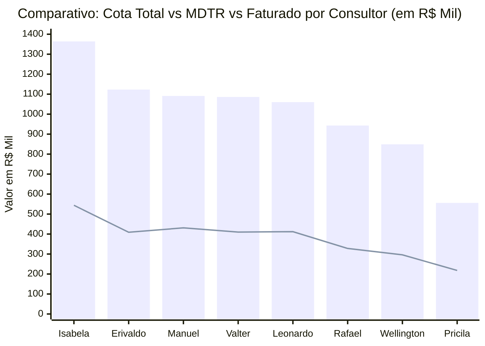
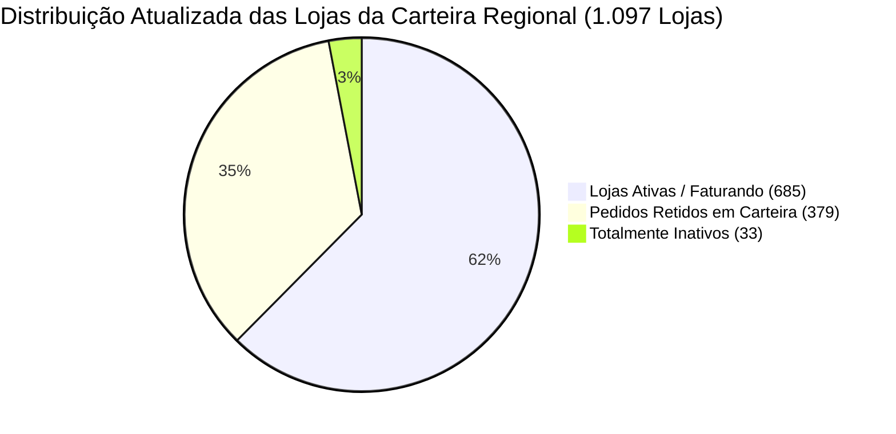

# Relatório de Análise Comercial: Setores, Cota, MDTR e Linhas Estratégicas
**Gerência Regional / Equipe:** 847010600 - JOSÉ CABRAL NETO  
**Arquivo Base:** [Acompanhamento 847010600 Outubro26.xlsx](file:///c:/Users/jose.cabral/OneDrive%20-%20Hypera/Documentos/Aula%20IA/Acompanhamento%20847010600%20Outubro26.xlsx)  
**Posição dos Dados:** MDTR até 14/10/2026 | Faturamento Bruto (Sales) até 19/10/2026  
**Dias Úteis no Mês:** 21 dias úteis (12 decorridos até 19/10 | 9 dias úteis restantes)

---

## 1. Resumo Executivo da Regional

| Indicador | Valor Consolidado (R$) | % Atingimento / Cobertura | Status e Observação |
| :--- | :---: | :---: | :--- |
| **Cota Total Regional** | **R$ 8.071.973,31** | 100,0% | Meta total estabelecida para Outubro/2026 |
| **MDTR Consolidado (14/10)** | **R$ 3.048.749,37** | **37,8%** | Ritmo acelerado de entrada de pedidos comercial |
| **Faturamento Bruto (19/10)** | **R$ 2.394.528,43** | **29,7%** | Faturamento efetivamente expedido e faturado |
| **GAP Restante para Cota 100%** | **-R$ 5.677.444,88** | 70,3% | Saldo pendente nos 9 dias úteis restantes |
| **Meta Intermediária Regional** | **R$ 4.893.633,82** | **60,6%** | Alvo intermediário da regional |
| **GAP Meta Intermediária** | **-R$ 2.499.105,39** | - | Montante a faturar para alcançar o marco intermediário |

> [!NOTE]
> No corte de 19/10, decorreram **57,1% dos dias úteis** do mês (12 de 21 dias). O faturamento realizado avançou de R$ 1,43M para **R$ 2,39M (29,7% da cota)** e o MDTR atingiu **R$ 3,05M (37,8%)**, demonstrando forte conversão de carteira e avanço vigoroso na expedição.

---

## 2. Gráfico e Ranking dos Setores: Cota vs MDTR

> 📊 **Painel Visual Interativo Disponível**: Abra o dashboard completo no navegador em:  
> 👉 **[grafico_ranking_setores.html](file:///c:/Users/jose.cabral/OneDrive%20-%20Hypera/Documentos/Aula%20IA/grafico_ranking_setores.html)** ou no **[GitHub Pages](https://cabralnetto26-ship-it.github.io/Acompanhamento-Outubro/)**

### 2.1. Gráfico de Cobertura de MDTR (%) vs Cota

O ranking atualizado classifica os consultores do **1º ao 8º lugar** com base na cobertura de MDTR frente à média regional (**37,8%**):

```text
Classificação | Consultor               | Cob. MDTR (%) | Gráfico de Barra Visual (Escala até 45%)
----------------------------------------------------------------------------------------------------
 1º LUGAR     | Isabela Cruccitti       | 39,9%         | [███████████████████████████████████████] ★ Líder
 2º LUGAR     | Manuel Artero           | 39,5%         | [██████████████████████████████████████ ] ★ Líder
 3º LUGAR     | Pricila Moreira         | 39,2%         | [██████████████████████████████████████ ] ★ Líder
 4º LUGAR     | Leonardo Mazzuco        | 38,9%         | [████████████████████████████████████   ]
----------------------------------------- MÉDIA REGIONAL: 37,8% ------------------------------------
 5º LUGAR     | Valter Pereira Jr       | 37,7%         | [███████████████████████████████████    ]
 6º LUGAR     | Erivaldo Maciel         | 36,4%         | [████████████████████████████████       ]
 7º LUGAR     | Wellington Morais       | 34,9%         | [██████████████████████████████         ]
 8º LUGAR     | Rafael Nascimento       | 34,8%         | [██████████████████████████████         ]
```

### 2.2. Comparativo de Volume Financeiro: Cota Total vs MDTR Realizado vs Faturado (R$)


*(Legenda: Colunas azuis = Cota Total em R$ Mil | Linha verde = MDTR realizado até 14/10 em R$ Mil)*

---

## 3. Ritmo Diário e Plano de Ação por Consultor (MDTR & Faturamento Necessário)

Para que cada consultor alcance **100% da sua cota** nos **9 dias úteis restantes** de Outubro, é necessário manter o seguinte ritmo diário de faturamento:

| Setor / Consultor | Cota Total (R$) | Faturado (19/10) | Gap Cota 100% (R$) | Faturamento Atual / Dia | **Fat. Diário Necessário (9 d.u.)** | Fator de Aceleração | Meta Interm. (R$) | **GAP Intermediária (R$)** |
| :--- | :---: | :---: | :---: | :---: | :---: | :---: | :---: | :---: |
| **847010605 - Isabela Cruccitti** | R$ 1.363.710,73 | R$ 522.638,38 | R$ 841.072,35 | R$ 43.553,20 | **R$ 93.452,48 / dia** | **2,1x** | R$ 940.960,40 | -R$ 418.322,02 |
| **847010607 - Manuel Artero** | R$ 1.090.998,13 | R$ 299.562,00 | R$ 791.436,13 | R$ 24.963,50 | **R$ 87.937,35 / dia** | **3,5x** | R$ 752.788,71 | -R$ 453.226,71 |
| **847010606 - Pricila Moreira** | R$ 556.481,27 | R$ 125.418,64 | R$ 431.062,63 | R$ 10.451,55 | **R$ 47.895,85 / dia** | **4,6x** | R$ 189.203,63 | -R$ 63.784,99 |
| **847010604 - Leonardo Mazzuco** | R$ 1.060.357,11 | R$ 359.366,33 | R$ 700.990,78 | R$ 29.947,19 | **R$ 77.887,86 / dia** | **2,6x** | R$ 731.646,41 | -R$ 372.280,08 |
| **847010608 - Valter Pereira Jr** | R$ 1.085.968,45 | R$ 195.882,21 | R$ 890.086,24 | R$ 16.323,52 | **R$ 98.898,47 / dia** | **6,1x** | R$ 705.879,49 | -R$ 509.997,28 |
| **847010603 - Erivaldo Maciel** | R$ 1.122.794,36 | R$ 308.612,11 | R$ 814.182,25 | R$ 25.717,68 | **R$ 90.464,69 / dia** | **3,5x** | R$ 774.728,11 | -R$ 466.116,00 |
| **847010602 - Wellington Morais** | R$ 848.780,32 | R$ 302.765,19 | R$ 546.015,13 | R$ 25.230,43 | **R$ 60.668,35 / dia** | **2,4x** | R$ 466.829,18 | -R$ 164.063,99 |
| **847010601 - Rafael Nascimento** | R$ 942.882,94 | R$ 280.283,57 | R$ 662.599,37 | R$ 23.356,96 | **R$ 73.622,15 / dia** | **3,2x** | R$ 518.585,62 | -R$ 238.302,05 |
| **TOTAL GERAL REGIONAL** | **R$ 8.071.973,31** | **R$ 2.394.528,43** | **R$ 5.677.444,88** | **R$ 199.544,04** | **R$ 630.827,21 / dia** | **3,2x** | **R$ 4.893.633,82** | **-R$ 2.499.105,39** |

---

## 4. Cobertura de Carteira, Positivação & Clientes Não Positivados (HYMPAR)

> 💡 **Painel Interativo de Clientes HYMPAR**: O dashboard comercial conta agora com uma aba dedicada de **Clientes Não Positivados no Hympar (405)** com filtros em tempo real por Consultor, Rede, Status (Não Comprou vs Comprou SG) e busca instantânea por CNPJ/Razão Social/Cidade. Acesse em:  
> 👉 **[grafico_ranking_setores.html](file:///c:/Users/jose.cabral/OneDrive%20-%20Hypera/Documentos/Aula%20IA/grafico_ranking_setores.html)** ou no **[GitHub Pages](https://cabralnetto26-ship-it.github.io/Acompanhamento-Outubro/)**

### 4.1. Resumo Consolidado e Ranking de Positivação por Consultor

A positivação de clientes avançou substancialmente, saltando de **579 para 692 positivados** (atingimento de **78,9% da meta**, restando apenas 185 clientes para o fechamento total da meta de 80% da regional):

| Consultor / Setor | Clientes na Base | Meta Positivação (80%) | Positivados PH | % Atingido | Saldo / Gap | Não Compraram Hympar | Cota Não Compradores (R$) |
| :--- | :---: | :---: | :---: | :---: | :---: | :---: | :---: |
| **847010604 - Leonardo Mazzuco** | 130 | 104 | 100 | **96,2%** | -4 | **30** | R$ 105.157,22 |
| **847010605 - Isabela Cruccitti** | 140 | 112 | 102 | **91,1%** | -10 | **38** | R$ 126.289,33 |
| **847010607 - Manuel Artero** | 135 | 108 | 98 | **90,7%** | -10 | **37** | R$ 139.739,78 |
| **847010603 - Erivaldo Maciel** | 139 | 111 | 95 | **85,6%** | -16 | **44** | R$ 169.789,59 |
| **847010602 - Wellington Morais** | 140 | 112 | 87 | **77,7%** | -25 | **53** | R$ 218.490,26 |
| **847010608 - Valter Pereira Jr** | 138 | 110 | 85 | **77,3%** | -25 | **53** | R$ 265.811,96 |
| **847010601 - Rafael Nascimento** | 143 | 114 | 85 | **74,6%** | -29 | **58** | R$ 260.672,50 |
| **847010606 - Pricila Moreira** | 132 | 106 | 40 | **37,7% ⚠️** | -66 | **92** | R$ 284.621,41 |
| **TOTAL REGIONAL** | **1.097** | **877** | **692** | **78,9%** | **-185** | **405** | **R$ 1.616.108,76** |

---

### 4.2. Diagnóstico dos Clientes Que Não Compram pelo Hympar

Na base de 1.097 lojas da regional, o cruzamento do indicador de positivação HYMPAR (`POS. HYMPAR`) identificou **405 clientes que não positivaram marcas no mês**, divididos em dois grupos:

1. **Totalmente Sem Compra Hympar (`Não Comprou`):** **385 lojas** que não registraram nenhuma compra de produtos participantes da cesta Hympar no mês.
2. **Compraram Similar/Genérico mas Não Compraram Marcas (`Comprou SG`):** **20 lojas** que já compram produtos da Hypera (linha similar/genérico), porém ainda não adquiriram marcas prioritárias Hympar (PH). Este grupo representa a **maior oportunidade de conversão rápida**, pois já possuem relacionamento e limite ativo no mês.

A cota total desses 405 clientes soma **R$ 1.616.108,76** (20,0% de toda a cota da regional).

---

### 4.3. Distribuição dos Não Compradores por Rede Farmacêutica

A inatividade no canal Hympar concentra-se majoritariamente nos seguintes grupos:
- **INDEPENDENTES VIN:** **175 lojas** sem compra Hympar (43,2% de todos os não compradores da regional).
- **ASSOCIADAS:** **54 lojas** sem positivação.
- **MASTERFARMA:** **46 lojas** sem positivação.
- **HIPER SAÚDE:** **22 lojas**.
- **ECONOMIZE RONDONÓPOLIS:** **16 lojas**.
- **COMPRE BEM:** **15 lojas**.
- **DSG FARMA:** **13 lojas**.
- **DROGARIA TOTAL:** **10 lojas**.
- **FARMARCAS:** **9 lojas** (altíssima taxa de positivação, apenas 9 pendentes de 134).
- **DEMAIS REDES:** **45 lojas** distribuídas em redes menores e regionais.

---

### 4.4. Top 20 Maiores Clientes Que Não Compram pelo Hympar

Abaixo estão relacionados os **20 maiores clientes em volume de cota** da regional que ainda não positivaram marcas pelo Hympar:

| # | CNPJ | Razão Social | Cidade / UF | Rede | Consultor | Cota do Mês (R$) | MDTR (R$) | Faturado (R$) | Status Hympar |
| :-: | :---: | :--- | :--- | :--- | :--- | :---: | :---: | :---: | :---: |
| 1 | `16825373000131` | **FARMACIA MAIS** | Rio Brilhante/MS | INDEPENDENTES VIN | Rafael Nascimento | **R$ 32.504,21** | R$ 7.702,00 | R$ 0,00 | Não Comprou |
| 2 | `11368538000170` | **FARMACIA INDEPENDENCIA** | Penápolis/SP | FARMARCAS | Valter Pereira Jr | **R$ 25.182,74** | R$ 15.581,09 | R$ 0,00 | Comprou SG (Sem Marcas) |
| 3 | `16926052000123` | **FARMA KILL** | São Gabriel do Oeste/MS | ASSOCIADAS | Wellington Morais | **R$ 20.021,72** | R$ 1.892,58 | R$ 0,00 | Não Comprou |
| 4 | `03480787000124` | **SAO JOSE I** | Aparecida do Taboado/MS | INDEPENDENTES VIN | Valter Pereira Jr | **R$ 19.260,20** | R$ 1.962,98 | R$ 0,00 | Não Comprou |
| 5 | `14931934000151` | **DROGARIA RIO FARMA** | Panorama/SP | DROGARIA TOTAL | Manuel Artero | **R$ 17.272,61** | R$ 4.580,82 | R$ 0,00 | Comprou SG (Sem Marcas) |
| 6 | `21746348000100` | **DROGARIAS ULTRA POPULAR** | Nova Xavantina/MT | FARMARCAS | Pricila Moreira | **R$ 16.199,93** | R$ 5.744,74 | R$ 0,00 | Não Comprou |
| 7 | `50357285000190` | **DROGARIAS FARMARELA** | Campo Grande/MS | ECONOMIZE RONDONÓPOLIS | Wellington Morais | **R$ 15.557,60** | R$ 5.317,61 | R$ 0,00 | Não Comprou |
| 8 | `19909093000108` | **DROGARIA ULTRAPOPULAR** | Sapezal/MT | FARMARCAS | Leonardo Mazzuco | **R$ 14.853,09** | R$ 7.141,04 | R$ 0,00 | Não Comprou |
| 9 | `29946302000139` | **DROGA CERTA** | Barra do Garças/MT | ASSOCIADAS | Pricila Moreira | **R$ 13.885,65** | R$ 1.610,81 | R$ 0,00 | Não Comprou |
| 10 | `05939112000126` | **FARMAVIDA FARMACIA** | Lucas do Rio Verde/MT | FARMARCAS | Leonardo Mazzuco | **R$ 13.036,98** | R$ 4.380,82 | R$ 0,00 | Não Comprou |
| 11 | `33540619000148` | **DROGARIA SEMPRE AMERICA** | Várzea Grande/MT | DSG FARMA | Erivaldo Maciel | **R$ 12.792,00** | R$ 3.032,31 | R$ 0,00 | Não Comprou |
| 12 | `51905753000187` | **FARMACIA POPULAR EM CASA** | Várzea Grande/MT | INDEPENDENTES VIN | Erivaldo Maciel | **R$ 12.611,39** | R$ 6.136,80 | R$ 0,00 | Não Comprou |
| 13 | `08856967000262` | **FARMACIA ECONOMIZE SINOP** | Sinop/MT | ECONOMIZE RONDONÓPOLIS | Isabela Cruccitti | **R$ 12.190,04** | R$ 2.164,13 | R$ 0,00 | Não Comprou |
| 14 | `4745484000159` | **FCIA SANTO ANTONIO** | Caarapó/MS | INDEPENDENTES VIN | Rafael Nascimento | **R$ 12.098,78** | R$ 4.298,90 | R$ 0,00 | Não Comprou |
| 15 | `10497520000105` | **DROG BOM JESUS PREVER** | Dracena/SP | DROGARIA TOTAL | Valter Pereira Jr | **R$ 11.760,24** | R$ 3.447,36 | R$ 0,00 | Não Comprou |
| 16 | `4344448000183` | **DROG RODOFARMA** | Três Lagoas/MS | INDEPENDENTES VIN | Valter Pereira Jr | **R$ 11.528,19** | R$ 2.051,29 | R$ 0,00 | Não Comprou |
| 17 | `29303719000183` | **DROGARIA PLANALTO** | Canarana/MT | COMPRE BEM | Pricila Moreira | **R$ 11.465,89** | R$ 3.069,35 | R$ 0,00 | Não Comprou |
| 18 | `17176661000175` | **FARMAIVI** | Ivinhema/MS | ASSOCIADAS | Rafael Nascimento | **R$ 11.353,77** | R$ 3.491,95 | R$ 0,00 | Não Comprou |
| 19 | `6368293000140` | **FARMACIAS MEIO PRECO INGAS** | Campo Novo do Parecis/MT | INDEPENDENTES VIN | Isabela Cruccitti | **R$ 11.331,05** | R$ 2.003,18 | R$ 0,00 | Não Comprou |
| 20 | `00982959000170` | **FCIA DROGAMARA** | Amambai/MS | INDEPENDENTES VIN | Rafael Nascimento | **R$ 11.070,46** | R$ 1.580,06 | R$ 0,00 | Não Comprou |

---

### 4.5. Oportunidade Tática Imediata: As 20 Lojas "Comprou SG (Sem Marcas)"

As **20 lojas** abaixo já demonstraram abertura e compraram produtos similares/genéricos da empresa no mês, mas **ainda não positivaram a linha de marcas prioritárias PH Hympar**. Uma abordagem focada nessas 20 contas oferece o menor atrito para positivação rápida:

| CNPJ | Razão Social | Cidade / UF | Rede | Consultor | Cota (R$) | MDTR (R$) |
| :---: | :--- | :--- | :--- | :--- | :---: | :---: |
| `11368538000170` | FARMACIA INDEPENDENCIA | Penápolis/SP | FARMARCAS | Valter Pereira Jr | R$ 25.182,74 | R$ 15.581,09 |
| `14931934000151` | DROGARIA RIO FARMA | Panorama/SP | DROGARIA TOTAL | Manuel Artero | R$ 17.272,61 | R$ 4.580,82 |
| `4538037000129` | FARMACIA SAO VICENTE II | Dracena/SP | MULTIDROGAS | Valter Pereira Jr | R$ 6.925,00 | R$ 667,26 |
| `1524705000170` | DROGA SANTOS | Junqueirópolis/SP | MULTIDROGAS | Manuel Artero | R$ 4.558,85 | R$ 383,00 |
| `52905500000176` | DROGARIA POPULAR | Maracaju/MS | COMPRE BEM | Wellington Morais | R$ 4.424,93 | R$ 1.743,42 |
| `55283212000115` | FARMACIA IRAPURU | Irapuru/SP | FARMAIS | Manuel Artero | R$ 4.184,43 | R$ 1.072,94 |
| `48808406000121` | FARMAIS | Tupi Paulista/SP | FARMAIS | Manuel Artero | R$ 4.127,05 | R$ 1.013,21 |
| `14511974000144` | FARMALINE | Campo Grande/MS | DSG FARMA | Wellington Morais | R$ 3.945,07 | R$ 336,39 |
| `35850980000192` | DROGARIA FARMACIL | Tupi Paulista/SP | DROGARIA TOTAL | Manuel Artero | R$ 3.824,47 | R$ 1.258,95 |
| `07530666000155` | FARMACIA SANTO ANTONIO | Presidente Venceslau/SP | REDE MULTIDROGAS | Manuel Artero | R$ 3.757,28 | R$ 483,18 |
| `68051770000180` | FARMACIA NOSSA SENHORA APARECIDA | Tupi Paulista/SP | DROGARIA TOTAL | Manuel Artero | R$ 3.655,89 | R$ 442,16 |
| `14562098000186` | DROG NOVA FARMA | Junqueirópolis/SP | MULTIDROGAS | Manuel Artero | R$ 3.421,79 | R$ 1.344,05 |
| `14995963000160` | DROGARIA FARMACIL | Dracena/SP | DROGARIA TOTAL | Valter Pereira Jr | R$ 3.391,24 | R$ 684,21 |
| `47545939000120` | PHARMA VIDA | Presidente Venceslau/SP | DROGARIA TOTAL | Manuel Artero | R$ 3.195,95 | R$ 738,19 |
| `35282559000109` | MAXI FARMA POPULAR | Dracena/SP | DROGARIA TOTAL | Valter Pereira Jr | R$ 3.176,57 | R$ 745,56 |
| `33502848000176` | FARMACIA SAO VICENTE | Dracena/SP | MULTIDROGAS | Valter Pereira Jr | R$ 2.923,94 | R$ 687,70 |
| `09439626000138` | DROGA PLUS | Santo Anastácio/SP | MULTIDROGAS | Valter Pereira Jr | R$ 2.378,39 | R$ 421,80 |
| `24660706000163` | DROGARIA SANTO ANTONIO | Caarapó/MS | ASSOCIADAS | Rafael Nascimento | R$ 1.391,37 | R$ 225,50 |
| `11157833000122` | SUPER POPULAR | Glória de Dourados/MS | INDEPENDENTES VIN | Rafael Nascimento | R$ 676,92 | R$ 32,54 |
| `10212006000120` | DROG TOTAL | Junqueirópolis/SP | DROGARIA TOTAL | Valter Pereira Jr | R$ 242,48 | R$ 51,75 |


---


## 5. Diagnóstico por Rede Farmacêutica & Clientes Sem Compra (BASE 600)

> 💡 **Painel Interativo de Redes e Clientes**: O dashboard comercial conta com uma aba dedicada de **Lojas Sem Compra / Zeradas (412)** com filtros em tempo real por Consultor, Rede, Status (Pedido Retido vs Inativo) e busca rápida por CNPJ/Razão Social. Acesse em:  
> 👉 **[grafico_ranking_setores.html](file:///c:/Users/jose.cabral/OneDrive%20-%20Hypera/Documentos/Aula%20IA/grafico_ranking_setores.html)** ou no **[GitHub Pages](https://cabralnetto26-ship-it.github.io/Acompanhamento-Outubro/)**

### 5.1. Panorama Geral de Inatividade e Faturamento Zero

O volume de lojas com faturamento zero caiu de **505 para 412 lojas** (redução expressiva de 93 lojas que foram positivadas e começaram a faturar entre os cortes de 13/10 e 19/10).

A cota travada em lojas zeradas caiu de **R$ 2,21 Milhões para R$ 1.637.283,23**:



1. **Pedidos Retidos em Carteira (`MDTR > 0` e `Sales == 0`):**
   - **379 lojas** com pedidos comerciais colocados totalizando **R$ 381.792,42 em MDTR**.
   - Cota dessas lojas: **R$ 1.584.339,82**.
   - **Ação:** Monitoramento ativo no CSC/Crédito para liberar a esteira e converter R$ 381,8k em vendas faturadas.

2. **Totalmente Inativos (`MDTR == 0` e `Sales == 0`):**
   - **33 lojas** sem qualquer pedido ou faturamento no mês (queda de 5 lojas frente às 38 anteriores).
   - Cota dessas lojas: **R$ 52.943,41**.
   - **Ação:** Reativação comercial focada via televendas ou visitação urgente.

---

### 5.2. Desempenho e Mapeamento de Lojas Zeradas por Rede Farmacêutica

| Rede Farmacêutica | Lojas Totais | Lojas Ativas | Lojas Zeradas | % Lojas Zeradas | Cota Total (R$) | Faturado Realizado (R$) | Cob. Fat (%) | Cota Zerada/Travada (R$) | Status e Diagnóstico Comercial |
| :--- | :---: | :---: | :---: | :---: | :---: | :---: | :---: | :---: | :--- |
| **FARMARCAS** | 134 | 123 | **11** | **8,2% ★** | R$ 1.908.084,27 | R$ 622.097,88 | 32,6% | **R$ 105.456,55** | Excelente tração (91,8% de positivação). Apenas 11 lojas pendentes. |
| **ASSOCIADAS** | 184 | 126 | **58** | **31,5%** | R$ 1.179.269,92 | R$ 516.200,98 | **43,8%** | **R$ 251.077,54** | Forte recuperação de faturamento (43,8% da cota faturada), com 41 lojas ativadas na semana. |
| **REDE SANTA CATARINA** | 38 | 38 | **0** | **0,0% ★** | R$ 395.139,60 | R$ 130.778,07 | 33,1% | **R$ 0,00** | **100% das lojas ativas e faturando.** Referência regional contínua. |
| **ECONOMIZE RONDONÓPOLIS** | 41 | 25 | **16** | **39,0%** | R$ 373.128,52 | R$ 131.722,20 | 35,3% | **R$ 87.690,42** | Boa cobertura no faturamento (35,3%), com 16 lojas menores zeradas. |
| **DSG FARMA** | 35 | 19 | **16** | **45,7%** | R$ 159.747,06 | R$ 55.319,76 | 34,6% | **R$ 54.460,62** | Alta cobertura em redes organizadas (34,6%). |
| **HIPER SAÚDE** | 66 | 43 | **23** | **34,8%** | R$ 507.636,64 | R$ 161.612,09 | 31,8% | **R$ 78.132,71** | Boa resposta de vendas, 23 lojas ainda em carteira. |
| **COMPRE BEM** | 28 | 12 | **16** | **57,1% ⚠️** | R$ 191.669,21 | R$ 42.297,26 | 22,1% | **R$ 62.547,45** | 16 lojas sem faturamento nos setores de Pricila Moreira e Rafael Nascimento. |
| **INDEPENDENTES VIN** | 334 | 155 | **179** | **53,6% ⚠️** | R$ 1.617.864,49 | R$ 322.557,22 | 19,9% | **R$ 650.768,30** | Concentra R$ 650,8k em cota travada. Requer positivação rápida na reta final. |
| **DROGARIA TOTAL** | 30 | 15 | **15** | **50,0%** | R$ 238.230,27 | R$ 40.049,54 | 16,8% | **R$ 102.982,66** | 15 lojas aguardando liberação nos setores de Valter e Manuel. |
| **MASTERFARMA** | 98 | 51 | **47** | **48,0% ⚠️** | R$ 474.946,28 | R$ 75.093,44 | 15,8% | **R$ 177.229,13** | Baixa cobertura (15,8%) e quase metade da rede zerada. |
| **OUTRAS REDES** | 9 | 4 | **5** | **55,6%** | R$ 77.522,50 | R$ 11.232,56 | 14,5% | **R$ 39.560,00** | Redes menores (Multidrogas, Farma & Farma, Rede Inova). |
| **TOTAL REGIONAL** | **1.097** | **685** | **412** | **37,6%** | **R$ 8.071.973,31** | **R$ 2.394.528,43** | **29,7%** | **R$ 1.637.283,23** | **Cota total travada em lojas zeradas: R$ 1,64 Milhões** |

---

### 5.3. Top 20 Maiores Clientes com Faturamento Zero (Cota Travada)

Abaixo estão relacionados os **20 maiores clientes em volume de cota** da regional que ainda não faturaram no mês:

| # | CNPJ | Razão Social | Rede Farmacêutica | Setor / Consultor | Cota Total (R$) | MDTR Retido (R$) | Status Operacional |
| :-: | :---: | :--- | :--- | :--- | :---: | :---: | :---: |
| 1 | `16825373000131` | **FARMACIA MAIS** | INDEPENDENTES VIN | Rafael Nascimento | **R$ 32.504,21** | R$ 7.702,00 | Pedido Retido |
| 2 | `11368538000170` | **FARMACIA INDEPENDENCIA** | FARMARCAS | Valter Pereira Jr | **R$ 25.182,74** | R$ 15.581,09 | Pedido Retido |
| 3 | `03381216000132` | **DROGARIA E CIRURGICA SANTA CECILIA** | INDEPENDENTES VIN | Manuel Artero | **R$ 22.238,17** | R$ 5.103,83 | Pedido Retido |
| 4 | `16926052000123` | **FARMA KILL** | ASSOCIADAS | Wellington Morais | **R$ 20.021,72** | R$ 1.892,58 | Pedido Retido |
| 5 | `03480787000124` | **SAO JOSE I** | INDEPENDENTES VIN | Valter Pereira Jr | **R$ 19.260,20** | R$ 1.962,98 | Pedido Retido |
| 6 | `14931934000151` | **DROGARIA RIO FARMA** | DROGARIA TOTAL | Manuel Artero | **R$ 17.272,61** | R$ 4.580,82 | Pedido Retido |
| 7 | `21746348000100` | **DROGARIAS ULTRA POPULAR** | FARMARCAS | Pricila Moreira | **R$ 16.199,93** | R$ 5.744,74 | Pedido Retido |
| 8 | `50357285000190` | **DROGARIAS FARMARELA** | ECONOMIZE RONDONÓPOLIS | Wellington Morais | **R$ 15.557,60** | R$ 5.317,61 | Pedido Retido |
| 9 | `15532062000111` | **DROG STO ANTONIO** | INDEPENDENTES VIN | Rafael Nascimento | **R$ 14.881,18** | R$ 4.880,49 | Pedido Retido |
| 10 | `19909093000108` | **DROGARIA ULTRAPOPULAR** | FARMARCAS | Leonardo Mazzuco | **R$ 14.853,09** | R$ 7.141,04 | Pedido Retido |
| 11 | `63937486000109` | **MEDEIROS & GALINDO** | DROGARIA TOTAL | Manuel Artero | **R$ 14.212,19** | R$ 2.454,84 | Pedido Retido |
| 12 | `29946302000139` | **DROGA CERTA** | ASSOCIADAS | Pricila Moreira | **R$ 13.885,65** | R$ 1.610,81 | Pedido Retido |
| 13 | `01134776000167` | **DROG SAO PAULO** | ASSOCIADAS | Isabela Cruccitti | **R$ 13.232,19** | R$ 4.636,83 | Pedido Retido |
| 14 | `05939112000126` | **FARMAVIDA FARMACIA** | FARMARCAS | Leonardo Mazzuco | **R$ 13.036,98** | R$ 4.380,82 | Pedido Retido |
| 15 | `33540619000148` | **DROGARIA SEMPRE AMERICA** | DSG FARMA | Erivaldo Maciel | **R$ 12.792,00** | R$ 3.032,31 | Pedido Retido |
| 16 | `18666741000414` | **DROGARIA MAX PROMISSAO** | FARMARCAS | Valter Pereira Jr | **R$ 12.687,21** | R$ 6.309,64 | Pedido Retido |
| 17 | `51905753000187` | **FARMACIA POPULAR EM CASA** | INDEPENDENTES VIN | Erivaldo Maciel | **R$ 12.611,39** | R$ 6.136,80 | Pedido Retido |
| 18 | `08856967000262` | **FARMACIA ECONOMIZE SINOP** | ECONOMIZE RONDONÓPOLIS | Isabela Cruccitti | **R$ 12.190,04** | R$ 2.164,13 | Pedido Retido |
| 19 | `4745484000159` | **FCIA SANTO ANTONIO** | INDEPENDENTES VIN | Rafael Nascimento | **R$ 12.098,78** | R$ 4.298,90 | Pedido Retido |
| 20 | `07625132000158` | **FCIA FARMA FACIL** | ASSOCIADAS | Erivaldo Maciel | **R$ 12.019,26** | R$ 2.923,62 | Pedido Retido |

> [!IMPORTANT]
> **Destaque Operacional:** A conta **DROGARIA ULTRA POPULAR PENAPOLIS** (anteriormente nº 1 zerada com cota de R$ 45,4k) **já iniciou seu faturamento**, demonstrando que o plano de ação de liberação de pedidos está surtindo efeito direto.  
> Novamente, **100% dos Top 20 atuais possuem pedidos colocados no MDTR**, totalizando **R$ 104.793,02 em pedidos prontos para faturamento**.

---

## 6. Recomendações e Plano Tático para os 9 Dias Úteis Restantes

1. **Aceleração da Liberação de Crédito para os R$ 381,8k em Pedidos Retidos**:
   - Priorizar a desova dos 20 maiores clientes (R$ 104,8k imediatos) para garantir entrada contínua de caixa e faturamento.
2. **Positivação Final HYMPAR (Faltam 185 clientes)**:
   - A regional já alcançou **78,9% da meta de positivação**.
   - Foco concentrado em **Pricila Moreira** (faltam 66 clientes para a meta) e **Rafael Nascimento** / **Valter Pereira Jr** (faltam 29 e 25 clientes, respectivamente).
3. **Ritmo de Faturamento para Meta Intermediária (R$ 4.893.633,82)**:
   - Saldo restante de **R$ 2.499.105,39** para a meta intermediária.
   - É necessário faturar **R$ 277.678,38 / dia** nos 9 dias úteis restantes para atingir o marco intermediário da regional.
4. **Foco no Canal INDEPENDENTES VIN**:
   - O canal possui 179 lojas sem compra. O uso de combos promocionais de fechamento de mês e prazos flexibilizados permitirá alavancar os setores de Erivaldo, Rafael e Wellington.
