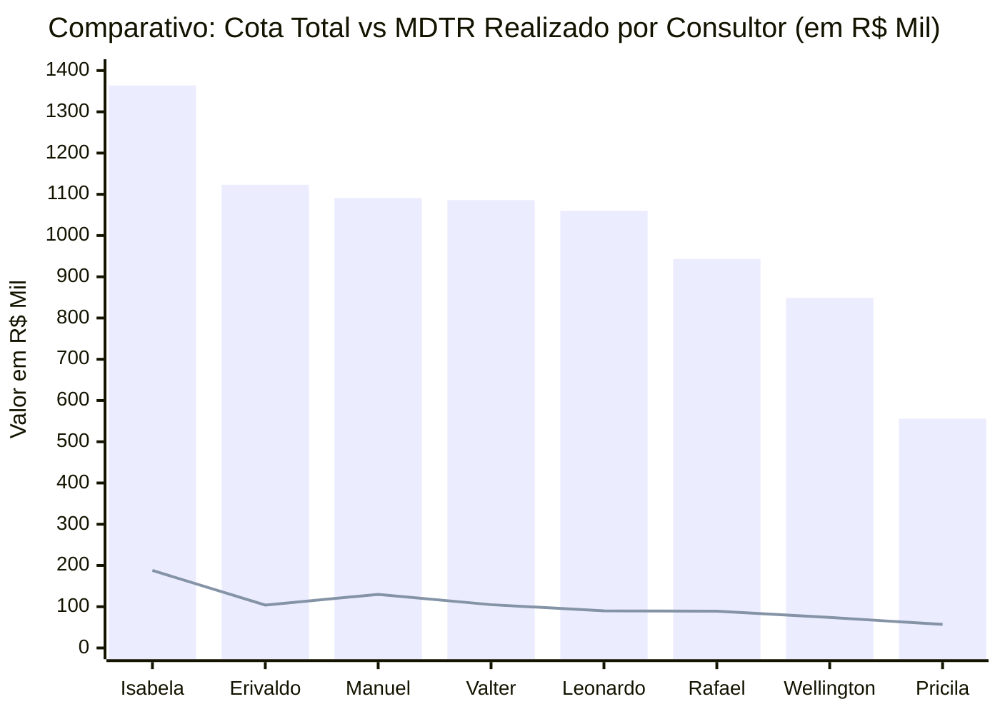

# Relatório de Análise Comercial: Setores, Cota, MDTR e Linhas Estratégicas
**Gerência Regional / Equipe:** 847010600 - JOSÉ CABRAL NETO  
**Arquivo Base:** [Acompanhamento 847010600 Outubro26.xlsx](file:///c:/Users/jose.cabral/OneDrive%20-%20Hypera/Documentos/Aula%20IA/Acompanhamento%20847010600%20Outubro26.xlsx)  
**Posição dos Dados:** MDTR até 05/10/2026 | Faturamento Bruto (Sales) até 08/10/2026  
**Dias Úteis no Mês:** 21 dias úteis (6 decorridos até 08/10 | 15 dias úteis restantes)

---

## 1. Resumo Executivo da Regional

| Indicador | Valor Consolidado (R$) | % Atingimento / Cobertura | Status e Observação |
| :--- | :---: | :---: | :--- |
| **Cota Total Regional** | **R$ 8.071.973,31** | 100,0% | Meta total estabelecida para Outubro/2026 |
| **MDTR Consolidado (05/10)** | **R$ 836.984,11** | **10,4%** | Ritmo de entrada de pedidos nos primeiros dias |
| **Faturamento Bruto (08/10)** | **R$ 642.363,76** | **8,0%** | Faturamento efetivamente faturado |
| **GAP Restante para Cota 100%** | **-R$ 7.429.609,55** | 92,0% | Saldo pendente para encerramento do mês |
| **Meta Intermediária Regional** | **R$ 4.893.633,82** | **60,6%** | Alvo intermediário da regional |
| **GAP Meta Intermediária** | **-R$ 4.251.270,06** | - | Montante a faturar para atingir o marco intermediário |

> [!NOTE]
> No corte de 08/10, haviam transcorrido **28,6% dos dias úteis** do mês (6 de 21 dias). O faturamento realizado de 8,0% frente a um MDTR de 10,4% reflete um volume relevante de pedidos em carteira aguardando aprovação de crédito, separação e expedição.

---

## 2. Gráfico e Ranking dos Setores: Cota vs MDTR

> 📊 **Painel Visual Interativo Disponível**: Abra o dashboard completo no navegador em:  
> 👉 **[grafico_ranking_setores.html](file:///c:/Users/jose.cabral/OneDrive%20-%20Hypera/Documentos/Aula%20IA/grafico_ranking_setores.html)**

### 2.1. Gráfico de Cobertura de MDTR (%) vs Cota

O gráfico abaixo classifica os consultores do **1º ao 8º lugar**, ilustrando visualmente o percentual da cota já alcançado no MDTR frente à média regional (**10,4%**):

```text
Classificação | Consultor               | Cob. MDTR (%) | Gráfico de Barra Visual (Escala até 15%)
----------------------------------------------------------------------------------------------------
 1º LUGAR     | Isabela Cruccitti       | 13,8%         | [████████████████████████████] ★ Líder
 2º LUGAR     | Manuel Artero           | 11,9%         | [████████████████████████    ]
 3º LUGAR     | Pricila Moreira         | 10,3%         | [█████████████████████       ]
----------------------------------------- MÉDIA REGIONAL: 10,4% ------------------------------------
 4º LUGAR     | Valter Pereira Jr       |  9,6%         | [███████████████████         ]
 5º LUGAR     | Rafael Nascimento       |  9,4%         | [███████████████████         ]
 6º LUGAR     | Erivaldo Maciel         |  9,3%         | [███████████████████         ]
 7º LUGAR     | Wellington Morais       |  8,7%         | [█████████████████           ]
 8º LUGAR     | Leonardo Mazzuco        |  8,5%         | [█████████████████           ]
```

### 2.2. Comparativo de Volume Financeiro: Cota Total vs MDTR Realizado (R$)


*(Legenda: Colunas azuis = Cota Total em R$ Mil | Linha verde = MDTR realizado até 05/10 em R$ Mil)*

---

## 3. Ritmo Diário e Plano de Ação por Consultor (MDTR Necessário)

Para que cada consultor alcance **100% da sua cota** nos **15 dias úteis restantes** de Outubro, é necessário manter o seguinte ritmo diário:

| Setor / Consultor | Cota Total (R$) | Faturado (08/10) | Gap Cota 100% (R$) | Faturamento Atual / Dia | **MDTR Diário Necessário (15 d.u.)** | Fator de Aceleração | Meta Interm. (R$) | **Diário p/ Meta Interm. (6 d.u.)** |
| :--- | :---: | :---: | :---: | :---: | :---: | :---: | :---: | :---: |
| **847010605 - Isabela Cruccitti** | R$ 1.363.710,73 | R$ 159.685,52 | R$ 1.204.025,21 | R$ 26.614,25 | **R$ 80.268,35 / dia** | **3,0x** | R$ 940.960,40 | R$ 130.212,48 / dia |
| **847010603 - Erivaldo Maciel** | R$ 1.122.794,36 | R$ 92.898,10 | R$ 1.029.896,26 | R$ 15.483,02 | **R$ 68.659,75 / dia** | **4,4x** | R$ 774.728,11 | R$ 113.638,34 / dia |
| **847010607 - Manuel Artero** | R$ 1.090.998,13 | R$ 94.177,28 | R$ 996.820,85 | R$ 15.696,21 | **R$ 66.454,72 / dia** | **4,2x** | R$ 752.788,71 | R$ 109.768,57 / dia |
| **847010604 - Leonardo Mazzuco** | R$ 1.060.357,11 | R$ 88.194,37 | R$ 972.162,74 | R$ 14.699,06 | **R$ 64.810,85 / dia** | **4,4x** | R$ 731.646,41 | R$ 107.242,01 / dia |
| **847010608 - Valter Pereira Jr** | R$ 1.085.968,45 | R$ 47.842,79 | R$ 1.038.125,66 | R$ 7.973,80 | **R$ 69.208,38 / dia** | **8,7x ⚠️** | R$ 705.879,49 | R$ 109.672,78 / dia |
| **847010601 - Rafael Nascimento** | R$ 942.882,94 | R$ 55.371,58 | R$ 887.511,36 | R$ 9.228,60 | **R$ 59.167,42 / dia** | **6,4x ⚠️** | R$ 518.585,62 | R$ 77.202,34 / dia |
| **847010602 - Wellington Morais** | R$ 848.780,32 | R$ 65.384,84 | R$ 783.395,48 | R$ 10.897,47 | **R$ 52.226,37 / dia** | **4,8x** | R$ 466.829,18 | R$ 66.907,39 / dia |
| **847010606 - Pricila Moreira** | R$ 556.481,27 | R$ 38.809,28 | R$ 517.671,99 | R$ 6.468,21 | **R$ 34.511,47 / dia** | **5,3x** | R$ 189.203,63 | R$ 25.065,73 / dia |
| **TOTAL GERAL REGIONAL** | **R$ 8.071.973,31** | **R$ 642.363,76** | **R$ 7.429.609,55** | **R$ 107.060,63** | **R$ 495.307,30 / dia** | **4,6x** | **R$ 4.893.633,82** | **R$ 708.545,01 / dia** |

> [!WARNING]
> **Alerta Operacional no Setor do Valter Pereira Jr (8,7x de Aceleração)**:  
> O consultor possui **R$ 104.638,22 no MDTR**, porém apenas **R$ 47.842,79 faturados** (conversão de apenas 45%). Mais de **R$ 56.000,00** em pedidos estão retidos entre digitação e emissão. Ação urgente necessária com a equipe de Crédito/Expedição.

---

## 4. Diagnóstico por Cliente e Rede (BASE 600)

### 4.1. Desempenho por Rede Farmacêutica

| Rede Farmacêutica | Lojas na Base | Cota Total (R$) | Faturado (R$) | % Cobertura | Status e Comportamento |
| :--- | :---: | :---: | :---: | :---: | :--- |
| **FARMARCAS** | 134 | R$ 1.908.084,28 | R$ 303.200,07 | **15,9%** | Maior volume da regional (Ultra Popular, Drogatop). |
| **INDEPENDENTES VIN** | 334 | R$ 1.626.198,58 | R$ 560.382,68 | **34,5%** | **Melhor taxa de conversão**. Forte resposta no canal direto. |
| **ASSOCIADAS** | 184 | R$ 1.179.269,92 | R$ 342.106,03 | **29,0%** | Boa tração de compras na primeira quinzena. |
| **HIPER SAÚDE** | 66 | R$ 507.636,64 | R$ 119.258,08 | **23,5%** | Grande peso nos setores de MS e MT. |
| **MASTERFARMA** | 98 | R$ 474.946,27 | R$ 155.408,38 | **32,7%** | Alta adesão ao faturamento. |
| **REDE SANTA CATARINA** | 38 | R$ 395.139,60 | R$ 40.795,21 | **10,3% ⚠️** | **Abaixo da média regional**. Requer alinhamento de central de compras. |
| **ECONOMIZE RONDONÓPOLIS** | 41 | R$ 373.128,52 | R$ 69.577,94 | **18,6%** | Concentrada no sul de MT (Erivaldo/Isabela). |
| **DROGARIA TOTAL** | 30 | R$ 238.230,26 | R$ 54.456,95 | **22,9%** | Faturamento constante. |
| **COMPRE BEM** | 28 | R$ 191.669,21 | R$ 46.630,45 | **24,3%** | Faturamento constante. |
| **DSG FARMA** | 35 | R$ 159.747,06 | R$ 63.763,21 | **39,9%** | Maior percentual de cobertura entre as redes organizadas. |

### 4.2. Curva ABC: Maiores Clientes da Regional e Lacunas Críticas

| CNPJ | Razão Social / Nome Fantasia | Rede | Consultor / Setor | Cota (R$) | Faturado (R$) | Cob. (%) | Diagnóstico |
| :--- | :--- | :--- | :--- | :---: | :---: | :---: | :--- |
| `09.039.622/0002-89` | **DRUGSTORE NEBRASCA 24H** | HIPER SAÚDE | Isabela Cruccitti | R$ 112.437,07 | R$ 15.487,77 | 13,8% | Maior cliente individual do time. |
| `20.103.913/0002-21` | **DROGARIA ULTRA NACIONAL** | ASSOCIADAS | Leonardo Mazzuco | R$ 109.379,36 | R$ 10.851,93 | 9,9% | Potencial de R$ 98k de faturamento pendente. |
| `01.997.520/0039-50` | **FARMACIA ODEON** | ODEON | Valter Pereira Jr | R$ 96.288,27 | R$ 1.679,27 | **1,7% ⚠️** | **Grave represamento**: faltam R$ 94,6k. |
| `04.114.403/0001-12` | **DROGARIAS ULTRA POPULAR** | FARMARCAS | Erivaldo Maciel | R$ 67.104,95 | R$ 14.342,60 | 21,4% | Bom andamento inicial. |
| `01.971.371/0001-97` | **DROGARIA ULTRA POPULAR** | FARMARCAS | Isabela Cruccitti | R$ 63.199,57 | R$ 14.342,60 | 22,7% | Bom andamento inicial. |
| `10.341.045/0001-83` | **DROGARIA ULTRAPOPULAR** | FARMARCAS | Leonardo Mazzuco | R$ 60.669,36 | R$ 5.045,97 | 8,3% | Gap de R$ 55,6k a ser trabalhado. |
| `13.435.712/0001-85` | **NEI DROGAS II** | COMPRE BEM | Leonardo Mazzuco | R$ 54.670,83 | R$ 4.265,36 | 7,8% | Gap de R$ 50,4k. |
| `10.341.045/0007-79` | **DROGARIA ULTRAPOPULAR** | FARMARCAS | Erivaldo Maciel | R$ 54.207,93 | R$ 7.584,43 | 14,0% | Tração em linha com a média. |
| `09.636.563/0001-39` | **DROGARIA SÃO MARCOS** | INDEPENDENTES | Manuel Artero | R$ 49.452,51 | R$ 4.394,56 | 8,9% | Gap de R$ 45,0k. |
| `01.997.520/0006-38` | **FARMACIA ODEON** | ODEON | Valter Pereira Jr | R$ 47.675,81 | R$ 852,67 | **1,8% ⚠️** | Segundo CNPJ da Odeon praticamente inativo. |
| `18.666.741/0001-71` | **DROGARIA ULTRA POPULAR PENAPOL** | FARMARCAS | Valter Pereira Jr | R$ 45.417,12 | R$ 234,25 | **0,5% ⚠️** | Cota de R$ 45k com faturamento irrisório. |

> [!IMPORTANT]
> **Alavancagem Imediata para o Setor 847010608 (Valter)**:  
> Somente 3 contas da sua carteira (**FARMACIA ODEON (x2)** e **ULTRA POPULAR PENÁPOLIS**) totalizam **R$ 189.381,20 em cota**, das quais apenas **R$ 2.766,19 foram faturadas (1,4%)**. Uma intervenção focada nessas 3 contas destravará quase 20% da cota do setor.

---

## 5. Raio-X das Linhas Estratégicas

### 5.1. SEMAVY (Risco Crítico Regional em Unidades)
- **Meta Regional:** 583 unidades (R$ 279.543,88).
- **Realizado até 08/10:** apenas **40 unidades** (6,8%) e **R$ 13.606,33** (4,9%).
- **GAP:** 543 unidades / R$ 265.937,55.

| Consultor | Cota (R$) | Meta (Un.) | Fat. Bruto (R$) | Cob. Fat (%) | Unidades Faturadas | MDTR (Un.) | Status Operacional |
| :--- | :---: | :---: | :---: | :---: | :---: | :---: | :--- |
| **847010606 - Pricila Moreira** | R$ 16.368,11 | 34 un | R$ 3.626,72 | **22,2%** | 3 un | 3 un | **Líder em % da cota em R$**. |
| **847010605 - Isabela Cruccitti** | R$ 29.457,60 | 61 un | R$ 4.029,68 | **13,7%** | 7 un | 7 un | Boa tração de positivação. |
| **847010604 - Leonardo Mazzuco** | R$ 36.986,12 | 77 un | R$ 3.828,20 | **10,4%** | **15 un** | 15 un | **Maior volume físico de unidades**. |
| **847010603 - Erivaldo Maciel** | R$ 29.384,65 | 61 un | R$ 1.611,88 | **5,5%** | 2 un | 2 un | Baixo volume físico. |
| **847010608 - Valter Pereira Jr** | R$ 59.061,08 | 123 un | R$ 509,85 | **0,9%** | 7 un | 7 un | Maior cota em unidades, faturamento irrisório. |
| **847010601 - Rafael Nascimento** | R$ 42.061,44 | 88 un | **R$ 0,00** | **0,0% ⚠️** | 0 un | 3 un | Pedidos no MDTR aguardando faturamento. |
| **847010607 - Manuel Artero** | R$ 33.634,56 | 70 un | **R$ 0,00** | **0,0% ⚠️** | 0 un | 3 un | Pedidos no MDTR aguardando faturamento. |
| **847010602 - Wellington Morais** | R$ 32.590,32 | 68 un | **R$ 0,00** | **0,0% 🛑** | **0 un** | **0 un** | **Setor completamente zerado (MDTR e Fat).** |

### 5.2. LANÇAMENTOS (Cota Regional: R$ 135.879,31)
- **Realizado Regional:** R$ 8.924,77 (**6,6%** de cobertura).
- **Destaques Positivos:**
  - **Wellington Morais:** 14,1% faturado (R$ 2.388,29).
  - **Valter Pereira Jr:** 10,6% faturado (R$ 1.772,69).
  - **Isabela Cruccitti:** 10,1% faturado (R$ 2.195,25).
- **Pontos de Atenção:**
  - **Erivaldo Maciel:** apenas 0,9% (R$ 204,15 faturado contra cota de R$ 22,6k).
  - **Leonardo Mazzuco:** apenas 1,9% (R$ 334,16 faturado contra cota de R$ 17,3k).
  - **Pricila Moreira:** apenas 1,7% (R$ 120,07 faturado contra cota de R$ 7,1k).

### 5.3. PRODUTOS FOCO (Cota Regional: R$ 1.434.288,30)
- Representa **17,8% do faturamento total da regional**.
- **Realizado Regional:** R$ 112.923,82 (**7,9%** de cobertura), com MDTR em R$ 147.923,02 (**10,3%**).
- **Maior Volume:** Isabela Cruccitti (R$ 26,2k faturados / 11,2% de cobertura).
- **Divergência de Carteira:** Manuel Artero tem R$ 24,8k no MDTR (10,9%), porém faturou R$ 12,7k (5,6%), indicando pedidos de Foco retidos.

---

## 6. Cobertura de Carteira e Positivação (HYMPAR)

| Consultor / Setor | Clientes na Base | Meta Positivação | Positivados PH | % Atingido | Saldo / Gap |
| :--- | :---: | :---: | :---: | :---: | :---: |
| **847010607 - Manuel Artero** | 135 | 108 | 70 | **65%** | -38 |
| **847010604 - Leonardo Mazzuco** | 129 | 104 | 62 | **60%** | -42 |
| **847010605 - Isabela Cruccitti** | 140 | 112 | 67 | **60%** | -45 |
| **847010608 - Valter Pereira Jr** | 138 | 110 | 38 | **34%** | -72 |
| **847010601 - Rafael Nascimento** | 143 | 114 | 37 | **32%** | -77 |
| **847010603 - Erivaldo Maciel** | 139 | 111 | 34 | **31%** | -77 |
| **847010602 - Wellington Morais** | 140 | 112 | 35 | **31%** | -77 |
| **847010606 - Pricila Moreira** | 132 | 106 | 19 | **18% ⚠️** | -87 |
| **TOTAL REGIONAL** | **1.096** | **878** | **362** | **41,2%** | **-516** |

---

## 7. Inconsistência Cadastral Identificada na BASE 600

> [!CAUTION]
> **Erro de Fórmula / Código de Setor na Linha 3 da Planilha:**
> - **CNPJ:** `2787984614` (`DROGAPLUS POPULAR` - Cota: **R$ 7.262,32**).
> - **Código Atual:** `847164 - LEONARDO MAZZUCO` (faltam os dígitos centrais `010`).
> - **Impacto:** O PROCV das colunas K (MDTR), M (Sales) e R (Pos. Hympar) falha com erro `#N/D`, corrompendo a soma no cabeçalho da BASE 600.
> - **Ação:** Corrigir o setor para **`847010604 - LEONARDO MAZZUCO`** e acertar o CNPJ com 14 dígitos normais (`20787984000100` ou similar da matriz).

---

## 8. Recomendações e Plano Tático Semanal

1. **Ação Imediata Semavy (13/10 a 16/10)**:
   - Exigir entrada de pedidos com **Wellington Morais** (único consultor com zero pedidos e zero no MDTR).
   - Cobrar faturamento dos pedidos pendentes no MDTR de **Rafael Nascimento** e **Manuel Artero**.
2. **Desbloqueio de Carteira (Setor 847010608 - Valter)**:
   - Intervenção comercial e financeira nas contas **FARMACIA ODEON** e **ULTRA POPULAR PENÁPOLIS** (R$ 189k de cota reprimida).
3. **Plano de Positivação (HYMPAR)**:
   - Rota intensiva para **Pricila Moreira** (apenas 19 clientes positivados de 106 na meta).
   - Priorizar farmácias do canal **INDEPENDENTES VIN** e **ASSOCIADAS**, que respondem por mais de 50% das vendas faturadas da regional.
