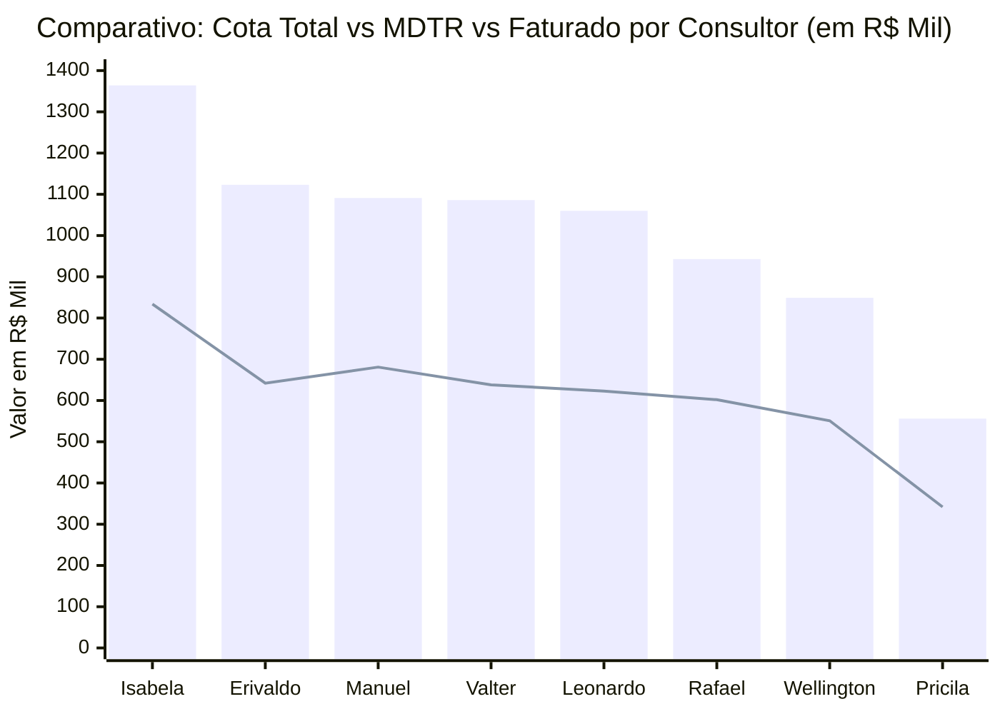

# Relatório de Análise Comercial: Setores, Cota, MDTR e Linhas Estratégicas
**Gerência Regional / Equipe:** 847010600 - JOSÉ CABRAL NETO  
**Arquivo Base:** [Acompanhamento 847010600 Outubro26.xlsx](file:///c:/Users/jose.cabral/OneDrive%20-%20Hypera/Documentos/Aula%20IA/Acompanhamento%20847010600%20Outubro26.xlsx)  
**Posição dos Dados:** MDTR até 20/10/2026 | Faturamento Bruto (Sales) até 22/10/2026  
**Dias Úteis no Mês:** 21 dias úteis (15 decorridos até 22/10 | 6 dias úteis restantes)

---

## 1. Resumo Executivo da Regional

| Indicador | Valor Consolidado (R$) | % Atingimento / Cobertura | Status e Observação |
| :--- | :---: | :---: | :--- |
| **Cota Total Regional** | **R$ 8.071.973,31** | 100,0% | Meta total estabelecida para Outubro/2026 |
| **MDTR Consolidado (20/10)** | **R$ 4.913.238,18** | **60,9%** | Ritmo acelerado de entrada de pedidos comercial |
| **Faturamento Bruto (22/10)** | **R$ 3.059.961,16** | **37,9%** | Faturamento efetivamente expedido e faturado |
| **GAP Restante para Cota 100%** | **-R$ 5.012.012,15** | 62,1% | Saldo pendente nos 6 dias úteis restantes |
| **Meta Intermediária Regional** | **R$ 5.145.882,99** | **63,8%** | Alvo intermediário da regional |
| **GAP Meta Intermediária** | **-R$ 2.085.921,83** | - | Montante a faturar para alcançar o marco intermediário |

> [!NOTE]
> No corte de 22/10, decorreram **71,4% dos dias úteis** do mês (15 de 21 dias). O faturamento realizado avançou para **R$ 3,06M (37,9% da cota)** e o MDTR atingiu **R$ 4,91M (60,9%)**, demonstrando forte conversão de carteira e avanço vigoroso na expedição com a regional consolidando **81,9% de positivação Hympar** (superando a meta de 80%).

---

## 2. Gráfico e Ranking dos Setores: Cota vs MDTR

> 📊 **Painel Visual Interativo Disponível**: Abra o dashboard completo no navegador em:  
> 👉 **[grafico_ranking_setores.html](file:///c:/Users/jose.cabral/OneDrive%20-%20Hypera/Documentos/Aula%20IA/grafico_ranking_setores.html)** ou no **[GitHub Pages](https://cabralnetto26-ship-it.github.io/Acompanhamento-Outubro/)**

### 2.1. Gráfico de Cobertura de MDTR (%) vs Cota

O ranking atualizado classifica os consultores do **1º ao 8º lugar** com base na cobertura de MDTR frente à média regional (**60,9%**):

```text
Classificação | Consultor               | Cob. MDTR (%) | Gráfico de Barra Visual (Escala até 70%)
----------------------------------------------------------------------------------------------------
 1º LUGAR     | Wellington Morais       | 65,0%         | [███████████████████████████████████████] ★ Líder
 2º LUGAR     | Rafael Nascimento       | 63,8%         | [██████████████████████████████████████ ] ★ Líder
 3º LUGAR     | Manuel Artero           | 62,4%         | [█████████████████████████████████████  ] ★ Líder
 4º LUGAR     | Pricila Moreira         | 61,5%         | [████████████████████████████████████   ] ★ Líder
 5º LUGAR     | Isabela Cruccitti       | 61,1%         | [████████████████████████████████████   ] ★ Líder
----------------------------------------- MÉDIA REGIONAL: 60,9% ------------------------------------
 6º LUGAR     | Leonardo Mazzuco        | 58,8%         | [███████████████████████████████████    ]
 7º LUGAR     | Valter Pereira Jr       | 58,8%         | [███████████████████████████████████    ]
 8º LUGAR     | Erivaldo Maciel         | 57,2%         | [████████████████████████████████       ]
```

### 2.2. Comparativo de Volume Financeiro: Cota Total vs MDTR Realizado vs Faturado (R$)


*(Legenda: Colunas azuis = Cota Total em R$ Mil | Linha verde = MDTR realizado até 20/10 em R$ Mil)*

---

## 3. Ritmo Diário e Plano de Ação por Consultor (MDTR & Faturamento Necessário)

Para que cada consultor alcance **100% da sua cota** nos **6 dias úteis restantes** de Outubro, é necessário manter o seguinte ritmo diário de faturamento:

| Setor / Consultor | Cota Total (R$) | Faturado (22/10) | Gap Cota 100% (R$) | Faturamento Atual / Dia | **Fat. Diário Necessário (6 d.u.)** | Fator de Aceleração | Meta Interm. (R$) | **GAP Intermediária (R$)** |
| :--- | :---: | :---: | :---: | :---: | :---: | :---: | :---: | :---: |
| **847010602 - Wellington Morais** | R$ 848.780,32 | R$ 355.358,87 | R$ 493.421,45 | R$ 23.690,59 | **R$ 82.236,91 / dia** | **3,5x** | R$ 466.829,18 | -R$ 111.470,31 |
| **847010601 - Rafael Nascimento** | R$ 942.882,94 | R$ 320.371,56 | R$ 622.511,38 | R$ 21.358,10 | **R$ 103.751,90 / dia** | **4,9x** | R$ 518.585,62 | -R$ 198.214,06 |
| **847010607 - Manuel Artero** | R$ 1.090.998,13 | R$ 427.251,62 | R$ 663.746,51 | R$ 28.483,44 | **R$ 110.624,42 / dia** | **3,9x** | R$ 763.698,69 | -R$ 336.447,07 |
| **847010606 - Pricila Moreira** | R$ 556.481,27 | R$ 161.439,63 | R$ 395.041,64 | R$ 10.762,64 | **R$ 65.840,27 / dia** | **6,1x** | R$ 306.064,70 | -R$ 144.625,07 |
| **847010605 - Isabela Cruccitti** | R$ 1.363.710,73 | R$ 665.222,69 | R$ 698.488,04 | R$ 44.348,18 | **R$ 116.414,67 / dia** | **2,6x** | R$ 954.597,51 | -R$ 289.374,82 |
| **847010604 - Leonardo Mazzuco** | R$ 1.060.357,11 | R$ 453.378,10 | R$ 606.979,01 | R$ 30.225,21 | **R$ 101.163,17 / dia** | **3,3x** | R$ 742.249,98 | -R$ 288.871,88 |
| **847010608 - Valter Pereira Jr** | R$ 1.085.968,45 | R$ 312.093,47 | R$ 773.874,98 | R$ 20.806,23 | **R$ 128.979,16 / dia** | **6,2x** | R$ 705.879,49 | -R$ 393.786,02 |
| **847010603 - Erivaldo Maciel** | R$ 1.122.794,36 | R$ 364.845,22 | R$ 757.949,14 | R$ 24.323,01 | **R$ 126.324,86 / dia** | **5,2x** | R$ 785.956,05 | -R$ 421.110,83 |
| **TOTAL GERAL REGIONAL** | **R$ 8.071.973,31** | **R$ 3.059.961,16** | **R$ 5.012.012,15** | **R$ 203.997,41** | **R$ 835.335,36 / dia** | **4,1x** | **R$ 5.145.882,99** | **-R$ 2.085.921,83** |

---

## 4. Cobertura de Carteira, Positivação & Clientes Não Positivados (HYMPAR)

> 💡 **Painel Interativo de Clientes HYMPAR**: O dashboard comercial conta com uma aba dedicada de **Clientes Não Positivados no Hympar (378)** com filtros em tempo real por Consultor, Rede, Status (Não Comprou vs Comprou SG) e busca instantânea por CNPJ/Razão Social/Cidade. Acesse em:  
> 👉 **[grafico_ranking_setores.html](file:///c:/Users/jose.cabral/OneDrive%20-%20Hypera/Documentos/Aula%20IA/grafico_ranking_setores.html)** ou no **[GitHub Pages](https://cabralnetto26-ship-it.github.io/Acompanhamento-Outubro/)**

### 4.1. Resumo Consolidado e Ranking de Positivação por Consultor

A positivação de clientes avançou expressivamente, saltando para **719 lojas positivadas** (**81,9% de atingimento**, já superando a meta regional de 80%):

| Consultor / Setor | Clientes na Base | Meta Positivação (80%) | Positivados PH | % Atingido | Saldo / Gap | Não Compraram Hympar | Cota Não Compradores (R$) |
| :--- | :---: | :---: | :---: | :---: | :---: | :---: | :---: |
| **847010604 - Leonardo Mazzuco** | 130 | 104 | 103 | **99,0%** | -1 | **27** | R$ 98.421,15 |
| **847010607 - Manuel Artero** | 135 | 108 | 100 | **92,6%** | -8 | **35** | R$ 134.180,62 |
| **847010605 - Isabela Cruccitti** | 140 | 112 | 102 | **91,1%** | -10 | **38** | R$ 126.289,33 |
| **847010603 - Erivaldo Maciel** | 139 | 111 | 96 | **86,3%** | -15 | **43** | R$ 167.370,35 |
| **847010608 - Valter Pereira Jr** | 138 | 110 | 92 | **83,3%** | -18 | **46** | R$ 238.106,78 |
| **847010602 - Wellington Morais** | 140 | 112 | 93 | **83,0%** | -19 | **47** | R$ 189.510,95 |
| **847010601 - Rafael Nascimento** | 143 | 114 | 88 | **76,9%** | -26 | **55** | R$ 254.981,59 |
| **847010606 - Pricila Moreira** | 132 | 106 | 45 | **42,6% ⚠️** | -61 | **87** | R$ 271.042,62 |
| **TOTAL REGIONAL** | **1.097** | **878** | **719** | **81,9%** | **-158** | **378** | **R$ 1.479.903,39** |

---

### 4.2. Diagnóstico dos Clientes Que Não Compram pelo Hympar

Na base de 1.097 lojas da regional, o cruzamento do indicador de positivação HYMPAR (`POS. HYMPAR`) identificou **378 clientes que não positivaram marcas no mês**, divididos em dois grupos:

1. **Totalmente Sem Compra Hympar (`Não Comprou`):** **360 lojas** que não registraram nenhuma compra de produtos participantes da cesta Hympar no mês.
2. **Compraram Similar/Genérico mas Não Compraram Marcas (`Comprou SG`):** **18 lojas** que já compram produtos da Hypera (linha similar/genérico), porém ainda não adquiriram marcas prioritárias Hympar (PH). Este grupo representa a **maior oportunidade de conversão rápida**, pois já possuem relacionamento e limite ativo no mês.

A cota total desses 378 clientes soma **R$ 1.479.903,39** (18,3% de toda a cota da regional).

---

### 4.3. Distribuição dos Não Compradores por Rede Farmacêutica

| Rede Farmacêutica | Lojas Sem Compra PH | Cota Total (R$) | % da Cota Travada | Ação Estratégica Recomendada |
| :--- | :---: | :---: | :---: | :--- |
| **INDEPENDENTES VIN** | **170** | R$ 555.140,60 | 37,5% | Visita presencial e flexibilização de prazo via distribuidor |
| **ASSOCIADAS** | **50** | R$ 213.435,31 | 14,4% | Acionamento dos gestores regionais da associação para ativação de pedidos |
| **MASTERFARMA** | **40** | R$ 147.163,98 | 9,9% | Campanha de bonificação em cascata para lojas periféricas |
| **HIPER SAUDE** | **21** | R$ 68.863,45 | 4,7% | Alinhamento direto com consultores de MT e MS |
| **ECONOMIZE RONDONOPOLIS** | **16** | R$ 87.690,42 | 5,9% | Cobrança focal dos setores 847010603 e 847010606 |
| **COMPRE BEM** | **16** | R$ 62.547,45 | 4,2% | Apresentação da cesta de marcas para lojas já ativas em similares |
| **DSG FARMA** | **15** | R$ 49.903,57 | 3,4% | Resgate de pedidos pendentes no portal de compras |
| **DROGARIA TOTAL** | **14** | R$ 96.878,43 | 6,5% | Ativação imediata das 14 lojas (muitas já compram SG) |
| **FARMARCAS** | **8** | R$ 83.795,82 | 5,7% | Prioridade máxima para positivação das 8 lojas da principal rede parceira |
| **OUTRAS REDES** | **28** | R$ 114.484,36 | 7,7% | Acompanhamento descentralizado por consultor |
| **TOTAL NÃO COMPRADORES** | **378** | **R$ 1.479.903,39** | **100,0%** | **Injeção potencial de R$ 1,48M para a reta final** |

---

### 4.4. Top 15 Clientes com Maior Cota Sem Compra Hympar

| CNPJ | Razão Social | Rede | Consultor | Cota (R$) | MDTR 20/10 (R$) | Fat. Bruto 22/10 (R$) | Status Hympar |
| :--- | :--- | :--- | :--- | :---: | :---: | :---: | :--- |
| `11368538000170` | **FARMACIA INDEPENDENCIA** | FARMARCAS | Valter Pereira Jr | **R$ 25.182,74** | R$ 19.959,18 | R$ 0,00 | 🟡 **Comprou SG** |
| `16926052000123` | **FARMA KILL** | ASSOCIADAS | Wellington Morais | **R$ 20.021,72** | R$ 2.770,41 | R$ 0,00 | 🔴 Não Comprou |
| `3480787000124` | **SAO JOSE I** | INDEPENDENTES VIN | Valter Pereira Jr | **R$ 19.260,20** | R$ 7.050,23 | R$ 3.538,64 | 🔴 Não Comprou |
| `14931934000151` | **DROGARIA RIO FARMA** | DROGARIA TOTAL | Manuel Artero | **R$ 17.272,61** | R$ 8.573,85 | R$ 47,40 | 🟡 **Comprou SG** |
| `21746348000100` | **DROGARIAS ULTRA POPULAR** | FARMARCAS | Pricila Moreira | **R$ 16.199,93** | R$ 8.077,10 | R$ 0,00 | 🔴 Não Comprou |
| `50357285000190` | **DROGARIAS FARMARELA** | ECONOMIZE RONDONOPOLIS | Wellington Morais | **R$ 15.557,60** | R$ 6.942,28 | R$ 0,00 | 🔴 Não Comprou |
| `19909093000108` | **DROGARIA ULTRAPOPULAR** | FARMARCAS | Leonardo Mazzuco | **R$ 14.853,09** | R$ 9.594,59 | R$ 0,00 | 🔴 Não Comprou |
| `63937486000109` | **MEDEIROS & GALINDO** | DROGARIA TOTAL | Manuel Artero | **R$ 14.212,19** | R$ 3.919,15 | R$ 0,00 | 🟡 **Comprou SG** |
| `29946302000139` | **DROGA CERTA** | ASSOCIADAS | Pricila Moreira | **R$ 13.885,65** | R$ 7.235,86 | R$ 0,00 | 🔴 Não Comprou |
| `5939112000126` | **FARMAVIDA FARMACIA** | FARMARCAS | Leonardo Mazzuco | **R$ 13.036,98** | R$ 8.242,44 | R$ 0,00 | 🔴 Não Comprou |
| `33540619000148` | **DROGARIA SEMPRE AMERICA** | DSG FARMA | Erivaldo Maciel | **R$ 12.792,00** | R$ 5.766,80 | R$ 0,00 | 🔴 Não Comprou |
| `51905753000187` | **FARMACIA POPULAR EM CASA** | INDEPENDENTES VIN | Erivaldo Maciel | **R$ 12.611,39** | R$ 6.980,30 | R$ 0,00 | 🔴 Não Comprou |
| `8856967000262` | **FARMACIA ECONOMIZE SINOP** | ECONOMIZE RONDONOPOLIS | Isabela Cruccitti | **R$ 12.190,04** | R$ 4.704,96 | R$ 0,00 | 🔴 Não Comprou |
| `4745484000159` | **FCIA SANTO ANTONIO** | INDEPENDENTES VIN | Rafael Nascimento | **R$ 12.098,78** | R$ 8.563,33 | R$ 2.404,26 | 🔴 Não Comprou |
| `10497520000105` | **DROG BOM JESUS PREVER** | DROGARIA TOTAL | Valter Pereira Jr | **R$ 11.760,24** | R$ 5.763,89 | R$ 0,00 | 🔴 Não Comprou |

---

## 5. Diagnóstico de Redes Farmacêuticas & Clientes com Faturamento Zero

### 5.1. Evolução das Lojas com Faturamento Zero
- **Progresso de Ativação:** O contingente de lojas com faturamento zero recuou de **412 lojas** (19/10) para **355 lojas** (22/10), liberando mais de 57 lojas que iniciaram faturamento.
- **Cota Travada em Lojas Zeradas:** Caiu de R$ 1,64M para **R$ 1.357.441,30** (16,8% da cota da regional).
- **Concentração de Risco:** 68% da cota zerada está alocada em apenas 3 grupos: Independentes Vin (R$ 518K), Associadas (R$ 202K) e Masterfarma (R$ 143K).

---

## 6. Acompanhamento de Linhas Estratégicas: Lançamentos

| Consultor / Setor | Cota Lançamento (R$) | MDTR Lançamento (R$) | Cob. MDTR (%) | Fat. Bruto Lançamento (R$) | Cob. Fat (%) | Diferença Cota x MDTR (R$) |
| :--- | :---: | :---: | :---: | :---: | :---: | :---: |
| **847010605 - Isabela Cruccitti** | R$ 21.783,33 | R$ 17.368,80 | **79,7%** | R$ 19.660,63 | **90,3%** | -R$ 4.414,53 |
| **847010602 - Wellington Morais** | R$ 16.950,73 | R$ 9.318,02 | **55,0%** | R$ 9.899,13 | **58,4%** | -R$ 7.632,71 |
| **847010601 - Rafael Nascimento** | R$ 16.544,96 | R$ 9.006,61 | **54,4%** | R$ 6.000,10 | **36,3%** | -R$ 7.538,35 |
| **847010604 - Leonardo Mazzuco** | R$ 17.357,26 | R$ 8.392,75 | **48,4%** | R$ 11.526,68 | **66,4%** | -R$ 8.964,51 |
| **847010608 - Valter Pereira Jr** | R$ 16.789,36 | R$ 5.982,53 | **35,6%** | R$ 5.072,17 | **30,2%** | -R$ 10.806,83 |
| **847010607 - Manuel Artero** | R$ 16.635,41 | R$ 4.669,96 | **28,1%** | R$ 4.177,29 | **25,1%** | -R$ 11.965,45 |
| **847010603 - Erivaldo Maciel** | R$ 22.637,83 | R$ 6.324,46 | **27,9%** | R$ 5.078,93 | **22,4%** | -R$ 16.313,37 |
| **847010606 - Pricila Moreira** | R$ 7.180,42 | R$ 1.670,15 | **23,3%** | R$ 834,72 | **11,6%** | -R$ 5.510,27 |
| **TOTAL LANÇAMENTO** | **R$ 135.879,31** | **R$ 62.733,28** | **46,2%** | **R$ 62.249,65** | **45,8%** | **-R$ 73.146,03** |

---

## 7. Próximos Passos e Recomendações Prioritárias

1. **Sprint Final nos 6 Dias Úteis Restantes**:
   - Manter ritmo de expedição e faturamento médio de **R$ 347,7K / dia** para garantir a Meta Intermediária (R$ 5,15M).
2. **Conversão dos 18 Clientes SG no Hympar**:
   - Acionamento imediato dos 18 clientes que compraram similares/genéricos mas ainda não fecharam a cesta de marcas do Hympar.
3. **Desbloqueio de Carteira nos Clientes com MDTR Retido**:
   - Agilizar liberação de crédito para os clientes com pedidos lançados no MDTR que ainda não foram convertidos em faturamento faturado.